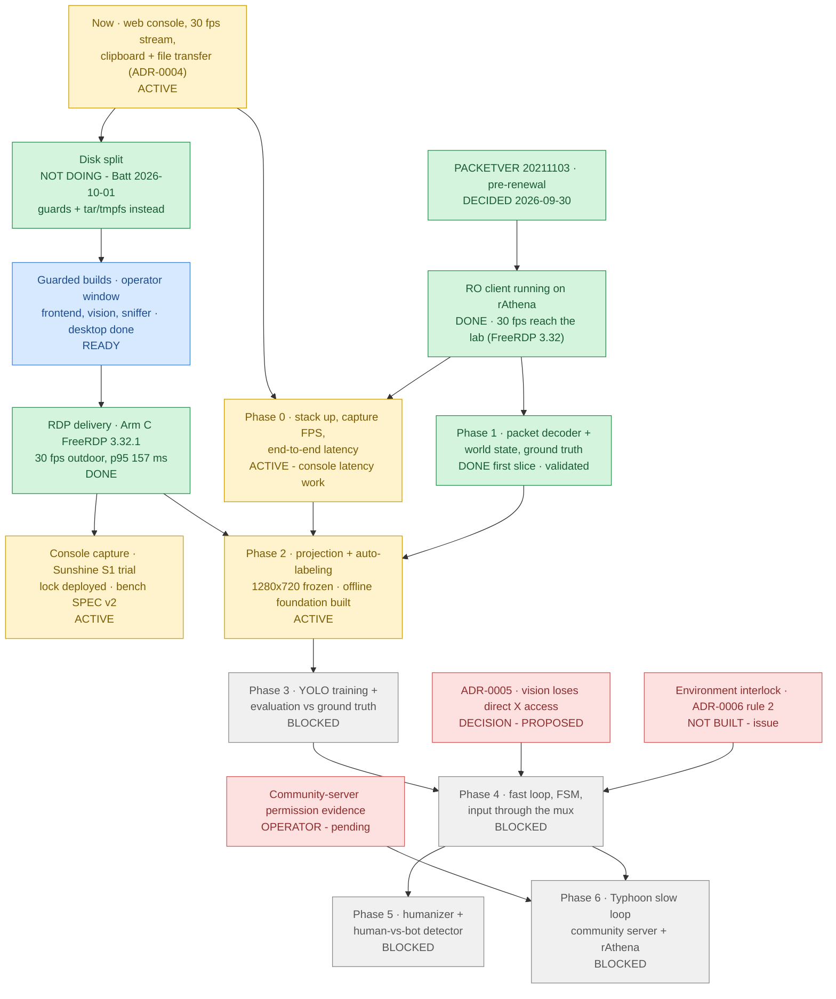

# poring-lab roadmap

## At a glance

| Step | Status | What it is | Blocker |
|---|---|---|---|
| **Now** | 🟡 ACTIVE | Web console on `frontend-dev` (tmpfs, no image builds); 30 fps stream; 24 h IO baseline in `data/metrics/`. **Clipboard paste + `\\tsclient\transfer` files ([ADR-0004](adr/0004-human-only-clipboard-and-file-transfer.md))**: ✅ deployed and live-verified 2026-09-30 11:34 ICT. ⌘V works directly on the remote screen (a hidden textarea captures the keys). Windows → Mac clipboard: future work, blocked on ADR-0005 + HTTPS. | Batt's manual checks: console keys/toolbar, paste ASCII + Thai, upload/download |
| **Disk split** | ✅ DECIDED: NOT DOING | Batt, 2026-10-01: no disk split. Keep the guards (`scripts/guarded_build.py`, tolerant `--sustain 30 --spike 25`) and the tar/tmpfs approach; don't plan around a split. | — |
| **Guarded builds** | 🔵 READY | Build the production frontend, vision and the slim sniffer (desktop: ✅ built 2026-10-01 with FreeRDP 3.32.1 and the ADR-0004 scripts baked in) -- one at a time through `scripts/guarded_build.py` in an operator-chosen window; then `scripts/smoke_test.sh` and `check_gpu.py` (sm_120). rathena and db: built 2026-09-30. | Operator picks the window (avoid the host cron at ~:03-:05, which alone drives quant-postgres io_full to 52-82 %) |
| **PACKETVER + RO client** | ✅ DECIDED | Batt, 2026-09-30: the 2021-11-03 kRO exe at **PACKETVER 20211103**, **pre-renewal**, kRO 2021-06 data, WARP patches ([docs/client/rathena-client.md](client/rathena-client.md)). | — |
| **RO client on rAthena** | ✅ DONE 2026-09-30 | A **separate client** in `C:\RO-rAthena\` logs in to this lab's rAthena. RagnarokClassic is untouched (a registry and folder baseline is compared at every step). What works: login, a character on `new_4-1`, movement. Thai typed via Kedmanee, rendered in chat, and stored byte-exact as CP874 in `chatlog`. Recipe: [rathena-client.md](client/rathena-client.md). ~~RDP session 1280×800 (2026-09-30). Game window 800×664 (client area 784×625)~~ ➡️ **2026-10-02: RDP session 1440×900, game window 1296×759 = a 1:1 1280×720 client area at (80,77), frozen for Phase 2** (the client renders at its client-area size; it was never scaled). dgVoodoo **FPSLimit 30**, and a "Ragnarok Offline" desktop shortcut (2026-10-01). **Render performance measured:** the game renders at **60 fps on the Intel UHD 630** (not WARP). Clicks register at 20 ms holds; UI click→response is p50 64 ms from release. English UI text applied (data only, 2026-10-01): no more `NO MSG`, and Thai chat is still byte-exact. Desktop is CPU-protected (weight 12, 8-core ceiling). **Open:** only ~6–17 fps reach Xvfb during full-scene motion. Windows RemoteFX counters show the server skipping 25–28 frames/s for "Insufficient Client Resources", so the bottleneck is FreeRDP decode ([phase0-latency.md](phase0-latency.md)). | **RDP delivery ceiling: must be fixed before dataset collection.** 2026-10-01: RDP session moved to the STANDARD account `poring-lab`; `RDP_GFX=progressive` doubled outdoor delivery (6 -> 12 fps); next a newer FreeRDP (H.264 row) |
| **Environment interlock · ADR-0006 rule 2** | 🟥 NOT BUILT | Fail-closed: the mux refuses BOT/ASSIST automation unless a verifiable signal (not the agent's judgment) says the connected server is rAthena or the community server. Until it exists, no agent automation runs on the community server; Batt may play there manually. [Issue #2](https://github.com/lumduan/poring-lab/issues/2), `blocks-phase-4`. | Design + implementation; a prerequisite of Phase 4 (with ADR-0005) |
| **Community-server permission evidence** | 🟥 OPERATOR | The server's bot/AI-testing rules, recorded for its exact host in [environments/community-server.md](environments/community-server.md). **Pending**, so the server counts as forbidden until then (ADR-0006 rule 1). | Batt supplies the link |
| **ADR-0005 · vision X isolation** | 🟥 DECISION | vision can reach XTEST, selections and window contents directly, and can pose as HUMAN on `:8000`. Recommended: frames from the backend + an X auth cookie + an internal agent network + no RECORD ([ADR-0005](adr/0005-vision-x-access.md); [issue #1](https://github.com/lumduan/poring-lab/issues/1), `blocks-phase-4`). | Operator picks the option set; implemented before Phase 4 |
| **Phase 0** | 🟡 ACTIVE (part) | Stack up; capture FPS; end-to-end (motion-to-photon) latency; RDP codec comparison (`RDP_GFX`). **Started 2026-09-30:** latency instrumentation, runtime knobs, and the probe ([phase0-latency.md](phase0-latency.md): method, results, ranked options, the Windows App A/B). **HP/SP text fidelity is now unblocked**: the RO client on rAthena works. | The agent-side grab rate needs the vision image |
| **Phase 1** | ✅ FIRST SLICE DONE 2026-10-01 | Packet decoder + world state as **offline ground truth**, never agent input ([ADR-0007](adr/0007-packet-ground-truth-channel.md) ACCEPTED). `poring_packets` (build-time length tables from pinned rAthena + OpenKore), the sniffer on the dev overlay (no build), `/ingest/packets` → console "Packet timeline" (`/ws/packets`, LAN viewers only), the `captures` volume, agent player + validation GM accounts. **Validated live** ([phase1-validation.md](phase1-validation.md)): server tick = host CLOCK_MONOTONIC (406 samples, 0–1 ms); position, chat (ASCII + Thai, byte-exact), HP and entities (5/5 within 1 cell) against GM/DB truth; 0 unknown ids, 0 desyncs; packet→frame p50 150 / p95 585 ms. | Next slices (combat, items) as Phase 2 needs them; GAT paths in Phase 2; slim sniffer image in a guarded build window |
| **RDP delivery (H.264)** | ✅ DONE 2026-10-01 | **Arm C: FreeRDP 3.32.1** (trixie-backports, one guarded desktop build) lifted the ceiling. `progressive` now delivers **30 fps outdoors** (was 9) and 17 indoors (was 7), Windows output 30 with **0 client skips** (was 17–20/s), 4.4–4.8 desktop cores (was 6.7–6.8), and packet→frame p50/p75/p90/p95 **119/139/151/157 ms** (was 242/1007/>1500/>1500). `AVCthin` matches the frames at ~1 core but is lossy; **progressive kept**. The client runs 26 threads, not 329. ⚠ 3.32 claims X CLIPBOARD (empty) on Windows copies, and the watchdog clears it (ADR-0004 amendment b). History: Arm A (AVC444 on 3.15, no gain); the AVC420 experiment. [h264-plan.md](h264-plan.md), "Arm C results". | Done. Open: Batt's live paste check on 3.32; optional FPSLimit 60 + DWMFRAMEINTERVAL now that delivery sits at the 30 fps cap |
| **Console capture (Sunshine; VNC fallback)** | 🟡 ACTIVE 2026-10-02 | **Batt approved Sunshine and the S1 trial** ("Sunshine research gets the weight"). Built: the **capture-backend lock** (`state/capture-backend`, `scripts/capture_backend.py`: rdp-loop and the new `gamestream` service each connect only under their backend; `/health` + console show it), the **benchmark SPEC v1** + `scripts/bench.py` (one fixed procedure for every backend), the `gamestream` service (moonlight-qt 6.1.0: absolute mouse via X events). Sunshine v2026.914.233613 installed by Batt after a signature check. [ADR-0009](adr/0009-console-session-capture.md) (revised), [benchmarks](benchmarks/README.md). **2026-10-02: the lock is deployed** (one guarded midday window; host, desktop, backend and `/health` agree). **SPEC v2** (1280×720 client): the RDP baseline is 23 fps outdoor (was 30 at 784×625), packet→frame p50 376 / p95 521 ms, key→paint p50 101 ms, static UI bit-exact. The larger frame made the RDP leg throughput-bound. | gamestream build + pairing (PIN, stop point), the tscon handover (stop point), A4 input checks, then `bench.py run --backend console` vs the **v2** RDP baseline. RDP stays the default |
| **Phase 2** | 🟡 ACTIVE (offline foundation) 2026-10-02 | Backend-agnostic, offline: `packages/poring_dataset` -- rAthena map caches at the pinned SHA + the exact A* port (walk paths), `Timeline` (world at a frame's time, per-backend latency offset), homography projection, YOLO labels, WebDataset shards, IoU metrics; `record_session.py`, `calibrate_projection.py`, `qa_export.py` + the console `/qa` page. [phase2-plan.md](phase2-plan.md), [ADR-0010](adr/0010-dataset-format.md) PROPOSED. **2026-10-02: resolution FROZEN at a 1:1 1280×720 client** (Batt). UI anchor map: registry, masked templates and measured geometry ([ADR-0011](adr/0011-ui-anchor-map.md) PROPOSED). | The live calibration recording AT 1280×720 (RDP mode); the persistent dataset sink (ADR-0010, Batt); then Phase 0's remaining numbers |
| **Phase 3** | ⬜ BLOCKED | YOLO training on the auto-labels + evaluation against ground truth on held-out sessions. | Phase 2 labels (and the vision image) |
| **Phase 4** | ⬜ BLOCKED | Fast loop: an FSM acting only through `/internal/agent` and the mux (ASSIST first; interventions logged). | Needs ALL of Phase 3 (perception), ADR-0005 implemented (its acceptance test passing), AND the environment interlock (ADR-0006 rule 2) |
| **Phase 5** | ⬜ BLOCKED | Humanizer (timing and trajectories of the bot's input) + a human-vs-bot detector trained on the human and bot input logs; target ROC-AUC toward 0.5. | Phase 4 bot traces |
| **Phase 6** | ⬜ BLOCKED | Typhoon slow loop (addressee detection and multi-party chat on the community server; deterministic tests on rAthena). The LLM emits **intents only**, consumed by the FSM; never in the fast loop. Any chat it writes goes through the mux as `source=bot`. | Phase 4 (independent of Phase 5); community-server experiments also need the permission evidence |

**The real bottlenecks are OPERATOR DECISIONS (build windows, ADR-0005, ADR-0009's install list) and the
environment interlock (ADR-0006).** The RDP delivery ceiling was removed on 2026-10-01 (Arm C).
- There is no disk split (Batt, 2026-10-01): image builds are deliberate, guarded steps in an operator-chosen
  window. Phase 1 needed none (dev-overlay sniffer).
- ~~**Dataset collection (Phase 2) waits for the RDP delivery ceiling**~~ ➡️ RESOLVED 2026-10-01 (Arm C):
  FreeRDP 3.32.1 delivers the game's full 30 fps outdoors ([h264-plan.md](h264-plan.md)). Phase 2 still
  needs Phase 0's remaining numbers (codec fidelity vs a lossless reference; agent-side grab rate) and
  Phase 1.
- Phase 4 cannot start until vision loses direct X access (ADR-0005) AND the environment interlock
  exists (ADR-0006), however good perception gets.
- Phase 6's social experiments also wait for the community server's permission evidence.
- Phase 0's desktop-only measurements have no blocker at all.

## Ideas / parked (kept, not scheduled -- Batt, 2026-10-02)

| Idea | Design notes so far | Why parked |
|---|---|---|
| **Hyper-V + XKore / NetRedirect / OpenKore study track** | A Windows VM (Hyper-V) running the RO client with OpenKore attached via XKore (client-side packet hook) or NetRedirect, to study a mature bot's decision loop against our rAthena. It must stay inside the sanctioned environments (ADR-0006: rAthena only) and never touch the community server; it is a separate research track, never the agent's input path (CLAUDE.md rule 1: pixels in, input out). | Queued after the console-capture work; needs its own ADR before any install |
| **FPSLimit 60 + DWMFRAMEINTERVAL 15** | Now actionable: FreeRDP 3.32.1 delivers the full 30 fps at FPSLimit 30 (h264-plan.md, Arm C). Raise dgVoodoo's FPSLimit to 60 and the DWM frame interval together, then re-run the benchmark (SPEC v1) per backend. | Kept for after the backend comparison, so one variable changes at a time |
| **Low-latency remote control for a driving game / a real drone** | The same stack (capture backend + benchmark SPEC + mux) applied to a latency-critical target: the key->paint and packet->frame metrics become control-loop latency budgets. | An idea only; no design yet |

## Ordered plan

1. **Now** (2026-09-29/30): web console, fps fix, 24 h IO baseline, ADR-0004 clipboard + file
   transfer. In parallel, because nothing blocks it: Phase 0 on desktop content (motion-to-photon, codec
   comparison).
2. ~~**Weekend:** disk split~~ ➡️ NOT DOING (Batt, 2026-10-01): guards + tar/tmpfs instead.
3. **Guarded builds, operator-chosen window** (no split):
   - guarded builds (`scripts/guarded_build.py`): frontend, desktop, sniffer (rathena and db: done 2026-09-30);
   - `scripts/smoke_test.sh`;
   - the vision build, then `check_gpu.py`.
4. ~~**RO client on rAthena**~~ ✅ done 2026-09-30. Next: Phase 0's HP/SP text fidelity, the client resolution, and Thai Test A vs B.
5. **Phase 1 → Phase 2 → Phase 3** as the graph allows. ADR-0005 and the environment interlock can
   be implemented any time before Phase 4, and the earlier the better.
6. **Phase 4**, then **Phases 5 and 6** in parallel.

## Phases (exit gates are proposals; adjust as the research sharpens)

| Phase | Scope | Exit gate |
|---|---|---|
| 0 · Stack up + measure | Capture FPS (backend and agent side); motion-to-photon latency (a mux-injected key toggles a large UI element; time to the first changed pixel, on one host clock); codec fidelity vs a lossless on-Windows screenshot (SSIM/PSNR), first on desktop content, then HP/SP text in the RO client | Numbers recorded; codec chosen |
| 1 · Packet decoder + world state | Offline decoder for the client's PACKETVER; world-state timeline (entities, positions, HP/SP, map) aligned to frames; cross-checked against rAthena logs | The decoded state matches the server on N sessions |
| 2 · Projection + auto-labeling | Calibrate isometric world → screen (zoom, camera) from ground-truth positions; generate YOLO labels by projection | Projection error within an agreed pixel bound; an auto-labelled dataset of agreed size |
| 3 · YOLO + evaluation | Train on the auto-labels; precision/recall vs projected ground truth on held-out sessions | Above an agreed bar |
| 4 · Fast loop (FSM) | Scripted FSM through `/internal/agent` only; ASSIST first; the human lease handles interventions | Stable multi-hour run; interventions logged; ADR-0005 acceptance test green |
| 5 · Humanizer + detector | Detector on human vs bot input logs; humanizer shapes bot input | Detector ROC-AUC near 0.5 on held-out data |
| 6 · Typhoon slow loop | Addressee detection and multi-party chat on the community server; deterministic tests on rAthena. LLM intents (goals) → FSM; never in the fast loop | Intents steer the FSM with no added fast-loop latency; addressee detection scored on community-server chat (pseudonymized) |

Hard rule throughout: pixels in, mouse/keyboard out.
- Packet and server-log data are only ever *offline* ground truth (Phases 1–3), never agent input
  (see `CLAUDE.md`).
- Clipboard and file transfer are human-only (ADR-0004).

## Maintenance

This is a **living document**. Any task that closes or materially advances an item here must update the
at-a-glance diagram, the status table and `last_reviewed` in the same change, not later.
