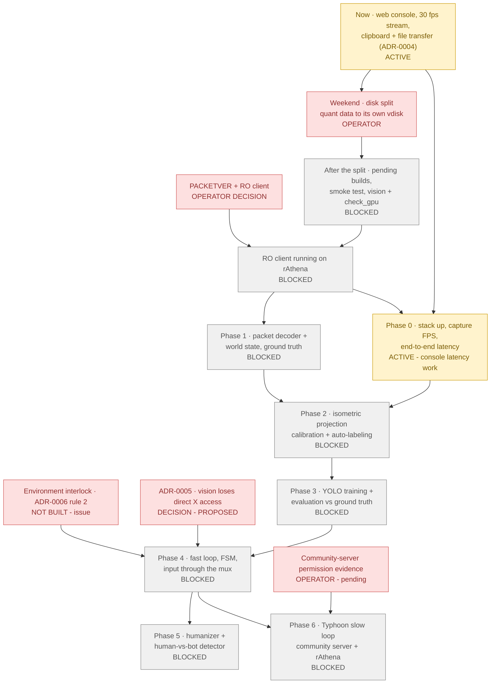

# poring-lab roadmap

## At a glance

| Step | Status | What it is | Blocker |
|---|---|---|---|
| **Now** | 🟡 ACTIVE | Web console on `frontend-dev` (tmpfs, no image builds); 30 fps stream; 24 h IO baseline in `data/metrics/`. **Clipboard paste + `\\tsclient\transfer` files ([ADR-0004](adr/0004-human-only-clipboard-and-file-transfer.md))**: ✅ deployed and live-verified 2026-09-30 11:34 ICT. ⌘V works directly on the remote screen (a hidden textarea captures the keys). Windows → Mac clipboard: future work, blocked on ADR-0005 + HTTPS. | Batt's manual checks: console keys/toolbar, paste ASCII + Thai, upload/download |
| **Weekend · disk split** | 🟥 OPERATOR | Move the quant Postgres/Mongo data to its own Proxmox vdisk; the window comes from the IO baseline (`scripts/io_summary.py`). | Operator, weekend |
| **After the split** | ⬜ BLOCKED | Build rathena, the production frontend, desktop (bakes the ADR-0004 `rdp-loop.sh`/`run-x11vnc.sh`, today bind-mounted by the dev overlay) and vision; pull db; `scripts/smoke_test.sh`; `check_gpu.py` (sm_120). | The disk split: on the shared disk, builds pushed capture Postgres past 25 % IO stall (2026-09-29) |
| **PACKETVER + RO client** | 🟥 OPERATOR | Which client executable date (PACKETVER); renewal or pre-renewal. Defaults: 20211103, renewal. | Operator decision; deferred |
| **RO client on rAthena** | ⬜ BLOCKED | A **separate client copy** on Windows logs in to this lab's rAthena. The existing community-server client stays untouched ([ADR-0006](adr/0006-sanctioned-test-environments.md)). | Needs BOTH the rathena image (after the split) AND the PACKETVER decision |
| **Environment interlock · ADR-0006 rule 2** | 🟥 NOT BUILT | Fail-closed: the mux refuses BOT/ASSIST automation unless a verifiable signal (not the agent's judgment) says the connected server is rAthena or the community server. Until it exists, no agent automation runs on the community server; Batt may play there manually. [Issue #2](https://github.com/lumduan/poring-lab/issues/2), `blocks-phase-4`. | Design + implementation; a prerequisite of Phase 4 (with ADR-0005) |
| **Community-server permission evidence** | 🟥 OPERATOR | The server's bot/AI-testing rules, recorded for its exact host in [environments/community-server.md](environments/community-server.md). **Pending**, so the server counts as forbidden until then (ADR-0006 rule 1). | Batt supplies the link |
| **ADR-0005 · vision X isolation** | 🟥 DECISION | vision can reach XTEST, selections and window contents directly, and can pose as HUMAN on `:8000`. Recommended: frames from the backend + an X auth cookie + an internal agent network + no RECORD ([ADR-0005](adr/0005-vision-x-access.md); [issue #1](https://github.com/lumduan/poring-lab/issues/1), `blocks-phase-4`). | Operator picks the option set; implemented before Phase 4 |
| **Phase 0** | 🟡 ACTIVE (part) | Stack up; capture FPS; end-to-end (motion-to-photon) latency; RDP codec comparison (`RDP_GFX`). **Started 2026-09-30:** latency instrumentation, runtime knobs, and the probe ([phase0-latency.md](phase0-latency.md): method, results, ranked options, the Windows App A/B). **HP/SP text fidelity waits** for a working RO client on rAthena. | Full exit needs "RO client on rAthena"; the agent-side grab rate needs the vision image |
| **Phase 1** | ⬜ BLOCKED | Packet decoder + world state as **offline ground truth** (sniffer pcaps + rAthena logs → a timeline of entities, positions, HP/SP, synchronised to frames by `t_mono_ns`). Never agent input. | RO client on rAthena (and the sniffer image, after the split) |
| **Phase 2** | ⬜ BLOCKED | Isometric projection calibration (world → screen for the client's camera) + auto-labeling (project the ground-truth world state into frames to make YOLO labels). | Needs BOTH Phase 0 (capture pipeline + chosen codec) AND Phase 1 (ground-truth positions) |
| **Phase 3** | ⬜ BLOCKED | YOLO training on the auto-labels + evaluation against ground truth on held-out sessions. | Phase 2 labels (and the vision image) |
| **Phase 4** | ⬜ BLOCKED | Fast loop: an FSM acting only through `/internal/agent` and the mux (ASSIST first; interventions logged). | Needs ALL of Phase 3 (perception), ADR-0005 implemented (its acceptance test passing), AND the environment interlock (ADR-0006 rule 2) |
| **Phase 5** | ⬜ BLOCKED | Humanizer (timing and trajectories of the bot's input) + a human-vs-bot detector trained on the human and bot input logs; target ROC-AUC toward 0.5. | Phase 4 bot traces |
| **Phase 6** | ⬜ BLOCKED | Typhoon slow loop (addressee detection and multi-party chat on the community server; deterministic tests on rAthena). The LLM emits **intents only**, consumed by the FSM; never in the fast loop. Any chat it writes goes through the mux as `source=bot`. | Phase 4 (independent of Phase 5); community-server experiments also need the permission evidence |

**The real bottlenecks are the SHARED DISK, OPERATOR DECISIONS, ADR-0005 and the environment
interlock (ADR-0006).**
- Every image build waits for the weekend disk split, and with it the RO client on rAthena. That is the
  root of Phase 1 and Phase 0's HP/SP fidelity.
- The PACKETVER/client decision gates the same node.
- Phase 4 cannot start until vision loses direct X access (ADR-0005) AND the environment interlock
  exists (ADR-0006), however good perception gets.
- Phase 6's social experiments also wait for the community server's permission evidence.
- Phase 0's desktop-only measurements have no blocker at all.

## Ordered plan

1. **Now** (2026-09-29/30): web console, fps fix, 24 h IO baseline, ADR-0004 clipboard + file
   transfer. In parallel, because nothing blocks it: Phase 0 on desktop content (motion-to-photon, codec
   comparison).
2. **Weekend:** disk split (operator), in the quietest window from `scripts/io_summary.py`.
3. **After the split:**
   - guarded builds (`scripts/guarded_build.py`): rathena, frontend, desktop, then `pull:db` and `up`;
   - `scripts/smoke_test.sh`;
   - the vision build, then `check_gpu.py`.
4. **RO client on rAthena**, once PACKETVER is decided. Then Phase 0's HP/SP text fidelity.
5. **Phase 1 → Phase 2 → Phase 3** as the graph allows. ADR-0005 and the environment interlock can
   be implemented any time before Phase 4, and the earlier the better.
6. **Phase 4**, then **Phases 5 and 6** in parallel.

## Phases (exit gates are proposals; adjust as the research sharpens)

| Phase | Scope | Exit gate |
|---|---|---|
| 0 · Stack up + measure | Capture FPS (backend and agent side); motion-to-photon latency (a mux-injected key toggles a large UI element; time to the first changed pixel, on one host clock); codec fidelity vs a lossless on-Windows screenshot (SSIM/PSNR), first on desktop content, then HP/SP text in the RO client | Numbers recorded; codec chosen |
| 1 · Packet decoder + world state | Offline decoder for the client's PACKETVER; world-state timeline (entities, positions, HP/SP, map) aligned to frames; cross-checked against rAthena logs | The decoded state matches the server on N sessions |
| 2 · Projection + auto-labeling | Calibrate isometric world → screen (zoom, camera) from ground-truth positions; generate YOLO labels by projection | Projection error within an agreed pixel bound; an auto-labelled dataset of agreed size |
| 3 · YOLO + evaluation | Train on the auto-labels; precision/recall vs projected ground truth on held-out sessions | Above an agreed bar |
| 4 · Fast loop (FSM) | Scripted FSM through `/internal/agent` only; ASSIST first; the human lease handles interventions | Stable multi-hour run; interventions logged; ADR-0005 acceptance test green |
| 5 · Humanizer + detector | Detector on human vs bot input logs; humanizer shapes bot input | Detector ROC-AUC near 0.5 on held-out data |
| 6 · Typhoon slow loop | Addressee detection and multi-party chat on the community server; deterministic tests on rAthena. LLM intents (goals) → FSM; never in the fast loop | Intents steer the FSM with no added fast-loop latency; addressee detection scored on community-server chat (pseudonymized) |

Hard rule throughout: pixels in, mouse/keyboard out.
- Packet and server-log data are only ever *offline* ground truth (Phases 1–3), never agent input
  (see `CLAUDE.md`).
- Clipboard and file transfer are human-only (ADR-0004).

## Maintenance

This is a **living document**. Any task that closes or materially advances an item here must update the
at-a-glance diagram, the status table and `last_reviewed` in the same change, not later.
