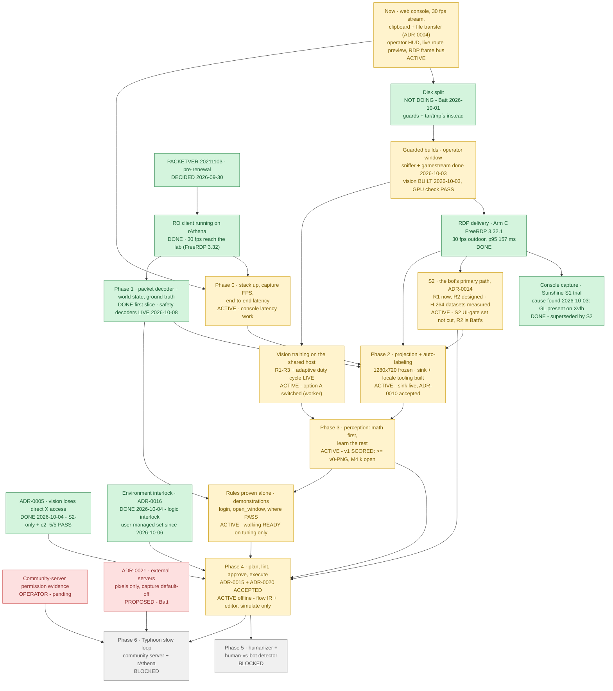

# poring-lab roadmap

## At a glance

| Step | Status | What it is | Blocker |
|---|---|---|---|
| **Now** | 🟡 ACTIVE | Web console on `frontend-dev` (tmpfs, no image builds); 30 fps stream; 24 h IO baseline in `data/metrics/`. **Clipboard paste + `\\tsclient\transfer` files ([ADR-0004](adr/0004-human-only-clipboard-and-file-transfer.md))**: ✅ deployed and live-verified 2026-09-30 11:34 ICT. ⌘V works directly on the remote screen (a hidden textarea captures the keys). Windows → Mac clipboard: future work, blocked on ADR-0005 + HTTPS. **2026-10-03:** the banner's D3D/"ro_agent recover" warning is RDP-only, and a clean room shows its variant, box and hard cap. ASSIST now comes back by itself after a GUARDED `restart:backend` ([ADR-0002](adr/0002-input-mux.md) amendment; never BOT, any other boot stays HUMAN), verified live twice. ➡️ **2026-10-07/09:** a per-tab "Watch only" toggle and no human release with nothing held (CLAUDE.md invariants); the **RDP frame bus**, the **operator HUD** and **LIVE-only route previews**, live since the 2026-10-08 17:45 backend restart ([phase4-ui.md](phase4-ui.md)); the HUD drift fix deployed 2026-10-09 00:36 ([demonstrations.md](demonstrations.md) "HUD scene"); the `/flows` editor (Phase 4 row). | Batt's manual checks: console keys/toolbar, paste ASCII + Thai, upload/download |
| **Disk split** | ✅ DECIDED: NOT DOING | Batt, 2026-10-01: no disk split. Keep the guards (`scripts/guarded_build.py`, tolerant `--sustain 30 --spike 25`) and the tar/tmpfs approach; don't plan around a split. | — |
| **Guarded builds** | ✅ vision BUILT 2026-10-03 19:24–19:55 (Batt: "do not wait for the timer") | ➡️ **2026-10-03 evening, the vision build ran NOW** (the 03:30 timer was disarmed and read back): `build:vision` rc 0 (19:24:53–19:43:15); `check_gpu` then FAILED with CUDA **error 804** (the base image's `cuda-compat` libcuda is newer than the R580 driver, and a GeForce cannot use forward compat); fixed by a last layer that removes the compat libs (a 20 s rebuild, `test_guards` pins it) → **`check_gpu` ALL PASS**: torch 2.14.0+cu130, sm_120, the 25 % cap enforced (3,962 MiB; 4,754 refused), matmul/conv fp32+fp16, a YOLO forward, no runtime downloads. Stall window 19:25:05–19:44:01 ICT = 12:25:05–12:44:01 UTC (`/dev/shm/poring-lab-tmp/vision-now/stall-window.txt`; Batt backfills from AWS); the fix run had none; no container restarts. The paragraphs below are the history. **2026-10-03 (Batt): the ~70 s quant stall is ACCEPTED** (he backfills it from AWS; weekends are the home servers' maintenance window). The `poring-vision-night` systemd --user timer fires at 03:30 ICT (5 min baseline), then `guarded_build.py --sustain 180 --spike 101 build:vision` (tolerates the known stall, still aborts a cgroup above 10 % for 3 min straight), then `run:vision check_gpu.py`; hard deadline 05:30. It records the STALL WINDOW (`pressure_sampler.py window`: 10 s bins with quant-postgres or orderbook io_full > 25 %, ICT + UTC) and container/GPU state before and after, all in `/dev/shm/poring-lab-tmp/vision-night/`. **Weekend window 2026-10-03 (tolerant guard):** - ✅ **slim sniffer** live (71 MB; [ADR-0007](adr/0007-packet-ground-truth-channel.md) decision 2 superseded); - ✅ **gamestream** with the clean-room variants and the S2 spike (364 MB); - ❌ **vision ABORTED twice.** 1st: quant-postgres 27.9 % while uv wrote ~3 GB of CUDA wheels. 2nd (uv throttled, after settling): orderbook 61–99 % and postgres 38–52 % within the first 15 s, while BuildKit resolved/unpacked the cuda base image. Per the rule, stopped and reported. - ❌ **3rd attempt (Batt's one-off guard for vision, `--sustain 60 --spike 101`, 14:13):** ABORTED again, sustained. orderbook 76.7 % for 60 s; quant-postgres 60–86 % per 10 s bin for ~70 s while uv wrote the ~5 GB install. No restarts. Not retried. - `check_gpu.py` is ready (cap enforcement + a runtime-download report) and runs via `guarded_build.py run:vision`. Still to build: the production frontend. Earlier: desktop ✅ 2026-10-01; rathena and db 2026-09-30. | ~~The night run's result~~ ➡️ done the same evening (no night run). Still to build: the production frontend. ~~**Batt:** vision needs a write-RATE cap … A tolerance change alone won't do it~~ ➡️ SUPERSEDED 2026-10-03: Batt accepted the stall instead (backfilled from AWS). Avoid the host cron at ~:03–:05. ➡️ **2026-10-09 19:50: the sniffer build carrying the credential-scrub fix (f36276e) ABORTED on the IO guard** 18 s in, inside a measured quiet window; ➡️ **2026-10-10 02:50: BUILT in the night slot** (quiet window, worst stall 6.5 %; scrub verified, §2a re-run: [demonstrations.md](demonstrations.md) §2a). Still PROPOSED: [ADR-0007](adr/0007-packet-ground-truth-channel.md) Amendment C (PROPOSED: the sniffer's code from a read-only mount in dev mode, no build for code changes). Vision starts: the training row below |
| **PACKETVER + RO client** | ✅ DECIDED | Batt, 2026-09-30: the 2021-11-03 kRO exe at **PACKETVER 20211103**, **pre-renewal**, kRO 2021-06 data, WARP patches ([docs/client/rathena-client.md](client/rathena-client.md)). | — |
| **RO client on rAthena** | ✅ DONE 2026-09-30 | A **separate client** in `C:\RO-rAthena\` logs in to this lab's rAthena. RagnarokClassic is untouched (a registry and folder baseline is compared at every step). What works: login, a character on `new_4-1`, movement. Thai typed via Kedmanee, rendered in chat, and stored byte-exact as CP874 in `chatlog`. Recipe: [rathena-client.md](client/rathena-client.md). ~~RDP session 1280×800 (2026-09-30). Game window 800×664 (client area 784×625)~~ ➡️ **2026-10-02: RDP session 1440×900, game window 1296×759 = a 1:1 1280×720 client area at (80,77), frozen for Phase 2** (the client renders at its client-area size; it was never scaled). dgVoodoo **FPSLimit 30**, and a "Ragnarok Offline" desktop shortcut (2026-10-01). **Render performance measured:** the game renders at **60 fps on the Intel UHD 630** (not WARP). Clicks register at 20 ms holds; UI click→response is p50 64 ms from release. English UI text applied (data only, 2026-10-01): no more `NO MSG`, and Thai chat is still byte-exact. Desktop is CPU-protected (weight 12, 8-core ceiling). **Open:** only ~6–17 fps reach Xvfb during full-scene motion. Windows RemoteFX counters show the server skipping 25–28 frames/s for "Insufficient Client Resources", so the bottleneck is FreeRDP decode ([phase0-latency.md](phase0-latency.md)). | **RDP delivery ceiling: must be fixed before dataset collection.** 2026-10-01: RDP session moved to the STANDARD account `poring-lab`; `RDP_GFX=progressive` doubled outdoor delivery (6 -> 12 fps); next a newer FreeRDP (H.264 row) |
| **Environment interlock · ADR-0006 rule 2** | ✅ BUILT + ACCEPTED 2026-10-04 ([ADR-0016](adr/0016-environment-interlock.md), rewritten) | ➡️ **Batt, 2026-10-04: NO firewall rule in the lab (it must stay flexible); a LOGIC interlock driven by a config allowlist.** `config/environments.yaml` (lab-rathena allowed, accounts 2000001/2000002; community-bot-testing pending, no signals): BOT presses pass only while the lock is steady, `WIN_HOST` matches and the sniffer's attestation (yes/no + account id + age, never world data) is ≤ 10 s old for a live lab session, or, in ASSIST only, a bounded operator window is open (`capture_backend.py window`, ≤ 120 s, tied to the lock SEQ). Releases always pass; green → red releases what the bot holds. Live 2026-10-04: green with the GM in game (RDP and console), ro_agent's login windows used for a recover, capture_backend's desktop window across its own tscon handover. ~~2026-10-03 design: four signals incl. an outbound firewall rule~~ (now the production option only). ➡️ **Layer 1 (Batt, 2026-10-05; APPLIED 2026-10-06 ~08:45-08:48):** an EXE-SCOPED allowlist for both lab clients (group `poring-lab lab-only`, 12 Block rules; ➡️ 2 since 2026-10-06 18:55 after ADR-0019's cleanup for everything but 192.168.1.13 and loopback; never OS-wide, never the community client), read back from the agent's shell; a watched login stayed green with the only remote 192.168.1.13:5121. Layer 2: the durable `poring-lab watch` task, re-triggered every 1 min (ADR-0013 amendment). ➡️ **[ADR-0019](adr/0019-windows-stays-clean.md) (Batt, 2026-10-06): layer 2 is LAB-ONLY** (not part of any user setup; retirement criteria proposed there). The client-side provider (Part C) and its Windows reporting channel (ADR-0013 Part B) are DEFERRED. [Issue #2](https://github.com/lumduan/poring-lab/issues/2). ➡️ **2026-10-06: the interlock reads the USER-MANAGED environment set** (`settings/environments.json`, seeded once from the YAML; human-only writes on the console's Settings page, CSRF + audit), with the typing-only foreground gate and the in-browser game-file finder ([ADR-0016](adr/0016-environment-interlock.md) "The environments"). | — (the community server stays forbidden: its entry is `pending` and has no signal set) |
| **Windows stays clean · [ADR-0019](adr/0019-windows-stays-clean.md)** | ✅ DECIDED 2026-10-06 (Batt) | The Windows PC runs the game and streams it; no poring-lab services, keys or reporting channels there; all intelligence and safety logic on the bot server. User setup = the game client with its one-time config + Sunshine ([windows-setup.md](windows-setup.md)). Official endpoints: drag a game file onto Settings. Live audit of the Dell 2026-10-06 (5 classes; the ONLY poring-lab program running is the lab-only `poring-lab watch` task, KILLED 0 since 2026-10-05 19:29). Part B / Part C and ADR-0013's indicator DEFERRED; future needs look server-side first. | ✅ cleanup DONE 2026-10-06 (Part 1 17:31, Part 2 18:55; read back: 2 rules = the 2 exes present, the Sunshine backup gone). 🟥 OPERATOR, later: AVC revert at the next reboot; 2026-11-05 review: archive the needed `_kro_exes_NEVER_RUN` originals to the NAS with sha256, delete the folder, re-decide the other revert material. The watch retires when ADR-0019's ACCEPTED criteria hold |
| **Community-server permission evidence** | 🟥 OPERATOR | The server's bot/AI-testing rules, recorded for its exact host in [environments/community-server.md](environments/community-server.md). **Pending**, so the server counts as forbidden until then (ADR-0006 rule 1). ➡️ **[ADR-0021](adr/0021-external-servers.md) PROPOSED 2026-10-09** (external servers: pixels only, packet capture default-off, a person-confirmed default-deny exe-scoped firewall). Batt's ~15:20 answers are recorded there; it stays PROPOSED, nothing is built, and the endpoint inventory ([endpoints-as-config.md](planning/endpoints-as-config.md), PROPOSED) waits for his review first. | Batt supplies the link; ADR-0021's acceptance |
| **ADR-0005 · vision X isolation** | ✅ CLOSED for S2 2026-10-04 | ➡️ **Batt: vision S2-only + option c2, built and accepted.** vision has no X mount, reads the bus only, and sits on the internal `agent` network (10.210.97.0/24, gateway isolated) with the backend alone; the backend refuses that subnet on every listener but `:8001`. The acceptance test (`services/vision/acceptance/adr0005.py`) passes **5/5 with S2 streaming** (no X; the public listener refused with and without a forged Origin; `/internal/agent` works; bus grab 31.2/s rising; the network closed). RDP-mode vision is unsupported. [ADR-0005](adr/0005-vision-x-access.md); [issue #1](https://github.com/lumduan/poring-lab/issues/1). | — |
| **Phase 0** | 🟡 ACTIVE (part) | Stack up; capture FPS; end-to-end (motion-to-photon) latency; RDP codec comparison (`RDP_GFX`). **Started 2026-09-30:** latency instrumentation, runtime knobs, and the probe ([phase0-latency.md](phase0-latency.md): method, results, ranked options, the Windows App A/B). **HP/SP text fidelity is now unblocked**: the RO client on rAthena works. | The agent-side grab rate needs the vision image |
| **Phase 1** | ✅ FIRST SLICE DONE 2026-10-01 | Packet decoder + world state as **offline ground truth**, never agent input ([ADR-0007](adr/0007-packet-ground-truth-channel.md) ACCEPTED). `poring_packets` (build-time length tables from pinned rAthena + OpenKore), the sniffer on the dev overlay (no build), `/ingest/packets` → console "Packet timeline" (`/ws/packets`, LAN viewers only), the `captures` volume, agent player + validation GM accounts. **Validated live** ([phase1-validation.md](phase1-validation.md)): server tick = host CLOCK_MONOTONIC (406 samples, 0–1 ms); position, chat (ASCII + Thai, byte-exact), HP and entities (5/5 within 1 cell) against GM/DB truth; 0 unknown ids, 0 desyncs; packet→frame p50 150 / p95 585 ms. | Next slices (combat, items) as Phase 2 needs them; GAT paths in Phase 2. (The slim sniffer image is live since 2026-10-03.) ➡️ **2026-10-07/08:** offline decoders for NPC dialogs, shops, stat/skill points, equipment, items and the attack click (bc1a2e6); the sniffer REBUILT 2026-10-08 07:31 (`attack_request` / `npc_contact` live) and 17:51 (5 variable-length packets, floor-item / pickup), each safety signal proven by a deliberate positive case ([demonstrations.md](demonstrations.md) §2a); banked captures re-decoded by `guarded_build.py replay:`. ~~**Open:** the credential-scrub fix (f36276e) is NOT live yet~~ ➡️ **LIVE since 2026-10-10 02:50** (scrub_check: user / password NOT FOUND; §2a re-proven on the new image); [ADR-0007](adr/0007-packet-ground-truth-channel.md) Amendment C PROPOSED |
| **RDP delivery (H.264)** | ✅ DONE 2026-10-01 | **Arm C: FreeRDP 3.32.1** (trixie-backports, one guarded desktop build) lifted the ceiling. `progressive` now delivers **30 fps outdoors** (was 9) and 17 indoors (was 7), Windows output 30 with **0 client skips** (was 17–20/s), 4.4–4.8 desktop cores (was 6.7–6.8), and packet→frame p50/p75/p90/p95 **119/139/151/157 ms** (was 242/1007/>1500/>1500). `AVCthin` matches the frames at ~1 core but is lossy; **progressive kept**. The client runs 26 threads, not 329. ⚠ 3.32 claims X CLIPBOARD (empty) on Windows copies, and the watchdog clears it (ADR-0004 amendment b). History: Arm A (AVC444 on 3.15, no gain); the AVC420 experiment. [h264-plan.md](h264-plan.md), "Arm C results". | Done. Open: Batt's live paste check on 3.32; optional FPSLimit 60 + DWMFRAMEINTERVAL now that delivery sits at the 30 fps cap |
| **Console capture (Sunshine; VNC fallback)** | ✅ CAUSE FOUND 2026-10-03 (clean room; it was PARKED 2026-10-02): Moonlight-qt's first SDL_RenderPresent hangs in Mesa llvmpipe GLX on Xvfb. Superseded by S2 | **Batt approved Sunshine and the S1 trial** ("Sunshine research gets the weight"). Built: the **capture-backend lock** (`state/capture-backend`, `scripts/capture_backend.py`: rdp-loop and the new `gamestream` service each connect only under their backend; `/health` + console show it), the **benchmark SPEC v1** + `scripts/bench.py` (one fixed procedure for every backend), the `gamestream` service (moonlight-qt 6.1.0: absolute mouse via X events). Sunshine v2026.914.233613 installed by Batt (➡️ 2026-10-02: that MSI had never run, and the April EXE install was running; REPLACED the same evening by the verified MSI, 2026.914.233613, with payload-verified binaries, pairing kept: [runbook](operations/sunshine-msi-replace.md)) after a signature check. [ADR-0009](adr/0009-console-session-capture.md) (revised), [benchmarks](benchmarks/README.md). **2026-10-02: the lock is deployed** (one guarded midday window; host, desktop, backend and `/health` agree). **SPEC v2** (1280×720 client): the RDP baseline is 23 fps outdoor (was 30 at 784×625), packet→frame p50 376 / p95 521 ms, key→paint p50 101 ms, static UI bit-exact. The larger frame made the RDP leg throughput-bound. **Paired** (exactly one client, ours). **Handover 1 stopped and recovered:** tscon from Batt's console failed (1326) and the console stayed 1920×1080 ([ADR-0009](adr/0009-console-session-capture.md)). **2026-10-02 evening (handovers 2–6), [ADR-0009](adr/0009-console-session-capture.md):** the Windows side works. VDD 1440×900 with Sunshine `ensure_only_display`, and tscon through Batt's SYSTEM task (exit 0); Mouse Keys stay off (Flags 62 before and after). Lab side: a **1920×1200 canvas** with `SESSION_SIZE=1440x900` at 0,0 is live (RDP `/size`; backend, vision and ro_agent crop to it; GAME_REGION unchanged), and Moonlight now opens its window at native 1440×900. Fixed along the way: the X focus left at None after a stream (keys vanished), the placer's window class, and llvmpipe's 64-thread pool throttling the 4-core quota. **OPEN: the stream stays black.** Moonlight's main thread stalls in a futex, so nothing is presented although video arrives (8.9 Mbit/s); the same with the software renderer and dummy audio. Handover 1 (no VDD) did render. **Any S1-vs-RDP number mixes protocol AND renderer** (Batt, 2026-10-02): S1's value is functional, and performance conclusions come from S2. **PARKED (Batt, 2026-10-02)** at "Windows side works, Moonlight-qt main loop stalls"; no gdb. Display investigation: **inconclusive**. Moonlight saw no mid-stream reconfiguration; Sunshine's own log is rewritten at each start, so its side is gone. Fact: TERM-killed clients left Sunshine's app running and later connects were `/resume`s. **to-rdp now ends the stream cleanly** (Moonlight `quit` → Sunshine /cancel), then checks the revert (rc 3 + remedy). Not yet exercised live. | none: superseded by **S2**. Its step 0 (a temporary Mac Moonlight pairing, Batt) answers S1's functional questions and whether the stall is lab-side. ~~The pending Sunshine display revert clears at the next console session~~ ➡️ SUPERSEDED 2026-10-02 22:15: the new Sunshine dropped it. ~~The Samsung stays off until Batt presses Win+P at the Dell~~ ➡️ SUPERSEDED 2026-10-03: Batt switched the Samsung on and asked for it to be restored WITHOUT Win+P through RDP. Read-only from RDP: connected and enumerated, inactive; the method (Sunshine `dd_configuration_option` disabled for the entry, `DisplaySwitch /extend` in the console session) is proposed in [s2-plan.md](s2-plan.md) §9a and waits for approval |
| **S2 · GameStream without Xvfb** | 🟡 ACTIVE: **the bot's primary capture + input path ([ADR-0014](adr/0014-s2-primary-bot-path.md), Batt 2026-10-03)**; step 3 (the input socket) BUILT 2026-10-03, live verification pending. Earlier: plan APPROVED 2026-10-02; the step 1 spike LIVE and reliable 2026-10-03; V3b (frame bus) measured 2026-10-03 | Batt's capture-direction note: decode the GameStream video ONCE (PyAV) in the `gamestream` service, into a shared-memory **frame bus**. The bot reads every frame; the human view (console JPEG) is capped, and both share `frame_id`/`t_mono_ns`. Input goes from the mux (all rules intact) to the GameStream input channel through a backend-only socket (`poring_env` `gamestream` backend). vision reads the bus read-only = ADR-0005 option (a) for this path. Shared viewing and shared control are designed only ([ADR-0013](adr/0013-windows-status-indicator.md) indicator; pixel-only human-presence detection; audit without keystrokes). Plan: [s2-plan.md](s2-plan.md); [ADR-0009](adr/0009-console-session-capture.md) 2026-10-02 amendment (APPROVED). [ADR-0013](adr/0013-windows-status-indicator.md) ACCEPTED (build later). ➡️ not built under [ADR-0019](adr/0019-windows-stays-clean.md) (Windows stays clean, 2026-10-06): server-side candidates first. **2026-10-03, step 0 attempt 1:** the Mac paired, but its app was started while the session was still on RDP (black, as expected), so nothing was tested. The lab's `quit` ended the Mac's app (`/cancel` is host-wide), and the Mac was unpaired and the firewall restored to `192.168.1.13`, both read back ([s2-plan.md](s2-plan.md) §9). | **2026-10-03 clean room (13:16–14:07)** ([ADR-0009](adr/0009-console-session-capture.md)): - V1/V2 Moonlight-qt BLACK: the first SDL_RenderPresent hangs in Mesa llvmpipe GLX on Xvfb; - **V3, the S2 spike, RELIABLE**: every functional check passes through the mux, and SPEC v2 gives 33 fps / packet→frame 119 ms / 1.5 cores vs RDP's 23 fps / 376 ms / ~4.5 cores; the key→paint tail is worse. ~~No blocker: **step 2, the frame bus**~~ ➡️ step 2 BUILT 2026-10-03 (0 torn frames in the torture test). ✅ **V3b clean room DONE 17:07–18:12** (ADR-0009 "Clean room 2"): the S2 client on the frame bus is reliable; key→paint p50/p95 121/277 ms (V3 138/350, RDP 101/114), packet→frame 114/268, **1.03 lab cores** (RDP 5.4), all measured on the bus. **The console is VDD-only by Batt's decision** ([console-display.md](operations/console-display.md)). ~~Next: the key→paint tail; S2 step 3 (the input socket, replacing the input-only X window)~~ ➡️ **2026-10-03 evening:** step 3 BUILT (8820b3c: mux → Injector → `s2-input` socket → LiSend*; an unmapped presence window keeps the interlocks; variant `S2`; `/health.input_sink`); the tail experiments are PRE-REGISTERED ([s2-latency-experiments.md](benchmarks/s2-latency-experiments.md), `bench.py exp`). ~~Next: ONE S2 session (A4 through the socket, the experiments, Phase 2 on S2)~~ ➡️ **DONE 2026-10-03 20:17 – 10-04 06:36** (two rooms):
- **A4 through the socket:** typing, GM `@where`, Thai Kedmanee byte-exact (`chatlog` 11), Mouse Keys 62; socket leg 0.7/1.8 ms.
- **The key→paint tail is CLOSED.** It was the evidence PNG on the decode thread. At 60 fps, S2 is 110.6/127.1/133.8 ms (pooled n = 120) against RDP's 101/114; the `S2` variant defaults to the winners ([s2-latency-experiments.md](benchmarks/s2-latency-experiments.md)).
- **Fixed live:** a re-stream SIGBUS (4 slots, pages reserved); the console's 1 fps (the damage wait on the bus); a watchdog that died at 4 h.
- ~~**Open:** packet loss upstream of the VM (one frame per ~10 s, each an IDR freeze); the resting state (R1/R2, Batt)~~ ➡️ **2026-10-04 (the Post-S2 round):**
  - **The resting state** is R1 now, R2 the target (ADR-0017 PROPOSED).
  - **Packet loss is mitigated, not chased:**
    - the frame-age guard (150 ms stream age / 400 ms cited);
    - `/health.framebus.stalls`;
    - freeze spans in manifests.

    The re-measurement: > 150 ms gaps 0.08/min, max 257 ms. The 06:28 drop was Batt's planned
    switch/AP maintenance.
  - **The watchdog is watched:** a guard timer raises RED `watchdog_down` (live: 51–61 s after the
    unit stopped). ➡️ **E2 re-test 2026-10-05 PASSED:** the box appeared by 11:41:50 and cleared on
    its own after the re-arm, with no refresh (Batt). The console's stale-status guard and its
    auto-reconnect stay.
  - **The one S2 session ran 10:11–11:38 ICT** (hard cap 13:11 untouched): ADR-0005 5/5, B2, B6′,
    C3, A3, and the interlock green throughout.
  - **Raw H.264 (C3):** 32–48 MB/min keeping every frame, bit-identical. The pre-registered rule
    keeps PNG (seek p95 314 ms; a stall comparison within noise); ~~the switch is Batt's (C4,
    [h264-vs-png.md](benchmarks/h264-vs-png.md))~~ ➡️ **Batt switched the default to H.264 at
    IDR 1 s (2026-10-04)**: the reader, the host determinism check (27,910 / 27,910), qa_export
    for both formats; the GM re-logs in by itself after a sniffer restart.
- ➡️ **2026-10-07 00:40:** the S2 `@stream` foreground template cut and verified (CLAUDE.md).
- ➡️ **2026-10-09: the S2 UI-gate set is NOT cut.** The UI gate (mandatory for every typed game
  line since 2026-10-09) and `gm_state` are path-aware (8112200): on the console path they read
  only a template set proven on S2. Until the one clean-room session in
  [s2-gate-templates.md](operations/s2-gate-templates.md) passes (Batt at the console for its four
  NPC clicks), nothing is typed on S2, so labels v2's collect@1 cannot run there. |
| **Phase 2** | 🟡 ACTIVE (offline foundation) 2026-10-02 | Backend-agnostic, offline: `packages/poring_dataset` -- rAthena map caches at the pinned SHA + the exact A* port (walk paths), `Timeline` (world at a frame's time, per-backend latency offset), homography projection, YOLO labels, WebDataset shards, IoU metrics; `record_session.py`, `calibrate_projection.py`, `qa_export.py` + the console `/qa` page. [phase2-plan.md](phase2-plan.md), [ADR-0010](adr/0010-dataset-format.md) PROPOSED. **2026-10-02: resolution FROZEN at a 1:1 1280×720 client** (Batt). UI anchor map: registry, masked templates and measured geometry ([ADR-0011](adr/0011-ui-anchor-map.md) PROPOSED). **2026-10-02 evening:** **dataset sink built** (`scripts/dataset_ship.py`: sha256 → rsync → re-hash on the NAS → INDEX → only then delete the local copy; SET-hours refusal; 365 d retention with pins; `record_session.py` records to `/home/batt/poring-lab-rec` with caps of 140 GB free / 20 GB unshipped). The operator recipe is [nas-sink.md](operations/nas-sink.md); ADR-0010 stays PROPOSED until the round-trip. **Language-agnostic UI** ([ADR-0012](adr/0012-locale-agnostic-ui.md) PROPOSED): the anchor map stores keys (`label_key`, never text), with masks that are locale-invariant (N-way); `grf_read.py` and `locale_pack.py` (canonical `msg.k` keys, alignment + coverage); the never-commit guard (`.gitignore` + `.githooks/pre-commit`). The guide is [locale-packs.md](locale-packs.md). **Part D** (resolution- and language-agnostic, one goal) is in [phase2-plan.md](phase2-plan.md); its first step, the session area on a 1920×1200 canvas, is live. **2026-10-02 21:06: the dataset sink is LIVE and [ADR-0010](adr/0010-dataset-format.md) is ACCEPTED**: a 30 s recording shipped to the NAS (re-hash verified, the local copy deleted); soft+automount NFS mounts on the VM. | ✅ **Thai copy DONE 2026-10-03:** data only, 434 files hash-verified, revoked, `@pristine-20261003`. **Part C:** C1–C3 done. `data.grf` is GRF 0x200 with standard flags; the text sources are plain; msgstringtable has 4,733 lines, a newer build than the lab's 3,970. ~~**C4 is BLOCKED on the kRO reference table** … Batt decides its source~~ ➡️ **2026-10-03, Batt decided: an OFFLINE PARSER of the exe's bytes** (never executed; WARP only as a cross-check). Built: `scripts/msgtable_extract.py` + `locale_pack.py --source-ref/--reindex/--source-untranslated`. ✅ **C4 DONE 2026-10-03:** the lab exe's table extracted (exactly 3,970 records; it is the KOREAN original, which corrects rathena-client.md's "embeds English"); the Thai exe is packed (WinLicense-style), so the ids were verified instead; the `th` pack is valid, 3,055/3,785 keys (80.7 %), a reindexed 3,970-line install table (3,223 Thai), printf-safe. `ro_thai` deleted (NAS copy 434/434 OK first). ~~**C5 BLOCKED: Windows refuses guest SMB**~~ ➡️ the guest share was refused by Windows (error 1272) and deleted unused; Batt chose a one-off through `\\tsclient\transfer`. ✅ **C5 DONE 16:07:** installed (hash = manifest), Thai frames, acceptance th + en on the registered windows: basic_info ✅ (after a Thai mask variant), hotbar ✅, open/close + HP read ✅, Thai chat HEX byte-exact ✅; chat window ❌ in BOTH languages (a stale template, not the pack). **English restored** as the baseline ([locale-packs.md](locale-packs.md) §6). Follow-ups: login/OK-Cancel/NPC anchors, the chat template re-cut. ✅ **2026-10-03 evening, S2-ready Phase 2:** recorder v3 (the bus `frame_id` per frame, stops on a non-bus frame, `--max-bytes` required); one camera per backend (`camera_rdp.json`, `camera_console.json` next); `qa_export` matches the offset run by backend + client + paint. **The perspective camera + GAT altitude beats the homography on held-out points** (leave-one-out 9.4/18.6 vs 14.7/26.6 px; static GM-spawn feet 6.0/6.7 vs 8.2/9.9): ported from nostalro-client/korangar, GAT via RagLite's layout and our own GRF header-DES ([THIRD_PARTY.md](../THIRD_PARTY.md), phase2-plan B4). ~~Next: the S2 calibration + anchors + the first datasets in the S2 session~~ ➡️ **DONE 2026-10-03/04:**
- `camera_console.json`: camera + GAT, leave-one-out 8.9/18.1 px.
- Stream variants: basic_info, hotbar and chat all locate in both scenes (basic_info's live margin is thin, 10.7 of 12).
- The first S2 datasets are on the NAS, verified: outdoor 20 min at fps 1, 2.59 GB, labels OK; indoor 20 min, 1.99 GB, **labels invalid**.
- **2026-10-04, the first H.264 datasets** (the Phase 3 S2 session, 13:01–15:34 ICT): 7 sessions, 119.4 min, 225,786 frames, 4.97 GB, shipped + verified; on-scene 101 min (the activity driver's three failures, all fixed the same day: [phase2-plan.md](phase2-plan.md) "The first H.264 datasets"); host determinism **225,786 / 225,786 frames identical** (`dataset_check.py`, 17:04).
- Batt set fps 1 after the 10 fps run tripped the IO guard ([phase2-plan.md](phase2-plan.md) "S2 datasets").
- ~~**Open:** an indoor camera; a hidden-NPC filter; an activity driver that never clicks entities~~ ➡️ **DONE 2026-10-04** (Post-S2 round Part B, live in the S2 session): the indoor camera is the client's own rule + a measurement (yaw +45.96°, distance 273; held-out spawns 11.5/21.7 px), hidden NPCs by class AND by invisibility option, an activity driver that clicks only empty walkable cells (GAT + the client's ground marker), facing labels, UI-occluded boxes dropped, the GPL `paths.py` replaced by a clean A* (walk.py: 2540/2540 recorded walks), a hand-check editor + `label_iou.py` (B6). The old indoor set is marked INVALID on the NAS; a new indoor set (B6′) exists. Raw H.264 datasets: C3 measured (h264-vs-png.md); ➡️ the DEFAULT since 2026-10-04 (Batt, C4).
- **Open:** ~~Batt's hand-check of a set (`/qa` editor) → `label_iou`~~ ➡️ done 2026-10-05 (the gold set; Phase 3 row); the login / OK-Cancel anchors (see [phase2-plan.md](phase2-plan.md)); ~~the NPC-dialog anchors (not started)~~ ➡️ the NPC dialog / menu readers are talk@1's T2/T3, proven live on RDP 2026-10-09, and the status / skills / inventory / equipment windows have anchors ([demonstrations.md](demonstrations.md) 3.30, 3.6) |
| **Vision training on the shared host (R1–R3, IO)** | 🟡 ACTIVE: ~~v1 TRAINING under option D~~ ➡️ v1 TRAIN DONE 2026-10-10 08:22 (30/30); option A PROVEN + SWITCHED 2026-10-10 ([vision-long-lived.md](operations/vision-long-lived.md) 5b); ➡️ **v1b (v1 continued, 20 epochs) TRAINED 2026-10-11/12 and SCORED: FAIL** (gold, monsters: P 0.888 / R 0.790 vs v1 0.902 / 0.830; better on the test sessions against v1's own labels) -> v1 stays the candidate ([v1b-vs-v1.md](benchmarks/v1b-vs-v1.md)); the first live mid-epoch resumes worked (2 camera aborts) | GPU sharing rules **R1–R3** (Batt 2026-10-07; CLAUDE.md rule 5): R3 measured like with like (paired ON/OFF windows by `docker pause`) and the **ADAPTIVE DUTY CYCLE** (training slows down, never stops for load; only camera frame drops stop it at once; an INCONCLUSIVE paired measurement holds the slowest level and re-measures, as on the night of 2026-10-09/10), enforced by `guarded_build.py` with verified stops ([r3-paired.md](operations/r3-paired.md)). The IO side: a vision COLD START stalled quant at ~100 % (2026-10-09 16:46), so **option D** (Batt, 2026-10-09): `quiet_start.py` starts ONE command after 10 measured quiet minutes, `MAX_ATTEMPTS=1`, no chained evals ([vision-long-lived.md](operations/vision-long-lived.md) §7). | **Option A** (one long-lived vision worker per day): BUILT + unit-tested, merged 4c5edbf; ➡️ **PROVEN 2026-10-10 (all four items of 5a) and SWITCHED** (the burst is a fresh container's FIRST CUDA run, not the start or the import; warm runs do not burst); its proof was pre-registered for after v1's training and before its evals ([vision-long-lived.md](operations/vision-long-lived.md) §5a: Batt's advance approval to switch only if every item passes). **Mid-epoch checkpoints:** proof 1 FAILED (B2); the fix merged (b9fd792); ➡️ **re-proof 2 PASSED 2026-10-11 00:45** (A == A2 bitwise, B bitwise equal after both resumes, digests restored; [mid-epoch-checkpoints.md](operations/mid-epoch-checkpoints.md)) ⇒ `MID_CKPT=1` for the next training run, and TEMP_HOLD EXITED (`TEMP_HOLD_MAX_LOAD = None`); v1 kept epoch-level checkpoints |
| **Phase 3** | 🟡 ACTIVE (plan APPROVED 2026-10-04 ~19:50, Batt) ➡️ **2026-10-10: ~~v1 TRAINING~~ v1 SCORED: at least as good as v0-PNG on the primary (gold, position, monsters: P 0.902 / R 0.830 vs 0.857 / 0.780; [v1-vs-v0png.md](benchmarks/v1-vs-v0png.md)); M4's k OPEN** | ~~YOLO training on the auto-labels + evaluation against ground truth on held-out sessions.~~ ➡️ **[phase3-plan.md](phase3-plan.md) PROPOSED 2026-10-04** (Batt's correction: on-screen scale is game mechanics). Compute everything deterministic (the billboard rule ported from nostalro/korangar → `predict_sprite`: box, facing, action/frame from packet state), PROVE it with pre-registered GM spawns (M4), then learn only occlusion, H.264 artefacts, effects and other players: exact labels v1 + an automatic label check, synthetic frames through a real H.264 encode, targeted GM collection, a frame cache split by session, YOLO11n under the 25 % VRAM cap, evaluation incl. Batt's gold set. **+ Tracking (Batt, same day, §6b):** tracks in WORLD cells with the engine's own motion rules (step timing, random walk, chase, mob_db speed, GAT), detector ~5 Hz + prediction at stream rate; occlusion and off-screen by prediction; packets evaluate it, never feed it. Needs an ADR-0015 ruling, PROPOSED: static game data at runtime for perception. | ~~Batt's approval of the plan and the ADR-0015 ruling; then one S2 session (M4) and a GPU window~~ ➡️ **2026-10-04/05:** approved, ADR-0015 ruling ACCEPTED, GPU window decided. M0/M2/M3/T0 done, the v0 cache built, a v0 BASELINE training ran in the night window. **M4 RECORDED 2026-10-05 but NOT PASSED** ([phase3-plan.md](phase3-plan.md) §5a: quad boxes from MIXCRYPT SPRs, species mix, indoor occlusion, no far spawns). ~~Now: Batt's MIXCRYPT a/b/c~~ ➡️ (a) decided 2026-10-05: M1 complete with a host-local study decoder. Now: ~~the B6 hand-check redo~~ (done 10-05 13:38) and the Thai-data experiment (separate client + rathena-th) ➡️ **3b/3c run 10-05 14:19-15:50** ([thai-data-experiment.md](thai-data-experiment.md) §4): the Thai GRF IN FRONT crashes the 2021 exe at start; Thai LAST works to in-game (interlock green as lab-rathena-th) but shows kRO art, ~~so 3d needs a selective overlay~~ ➡️ **moot: all 12 KB species' SPR+ACT are byte-identical to kRO (17:05)**, so the Thai data adds nothing for sprites or the four lab maps; Batt decides whether to switch. Found on the way: the exe calls Gravity's `kro-assit.ragnarok.co.kr:3000` at character select (data `AssistAddr`) ➡️ both clients overridden (config only, 16:23), a watched main login made no outbound call; the Equip window's missing textures explain the T3 freeze. Then the M4 re-run on the chosen setup ➡️ **2026-10-05 evening: Batt chose kRO (no switch); the M4 RE-RUN (§5b, pre-registered) ran and is NOT PASSED**: the perspective tests pass, but k from heights is within neither prior (0.1237; from widths 0.1421 = korangar) and the height miss is per species (Poring 0.85, Lunatic 1.08). ~~No v1 training.~~ ➡️ v1 trains on the pragmatic track since 2026-10-08 (below). Next: find the vertical term, re-fit the indoor camera ➡️ **2026-10-06, step 1 (phase3-plan §5c, Batt's order measurement → composition → k → indoor camera; rule chosen on odd spawns, frozen, scored once on even): NOT PASSED on the even half.** The measurement fix does not move the per-species split (Poring ~0.90, Lunatic ~1.12), so it is not a measurement artefact ➡️ SUPERSEDED 2026-10-07 by step 2d: the split IS in the measurement, in the ruler itself (§5d-v). Next: step 2, the per-species vertical term ➡️ **2026-10-06/07, M4 step 2 (§5d–5d-viii):** - the per-species split is IN THE MEASUREMENT (2d) and "not the facing" (2f, confirmed on both halves); **k stays OPEN until the fresh full M4 session** (§5d-vii, a plan that needs Batt's OK). - **The pragmatic v1 track** (§5e/5f): labels v1 at k = 0.140 (PROVISIONAL) point at monsters at least as well as v0 on the gold set; the IoU gate failed only because the gold set encodes v0's fixed 44×40 boxes. - **v0-PNG vs JPEG** ([v0-png-vs-jpeg.md](benchmarks/v0-png-vs-jpeg.md)): the domain-shift gain was the batch size, not the format. Batt 2026-10-09: future caches are JPEG q95; v1 stays PNG as pre-registered. - **v1 (cache v1png-20261008) is TRAINING**, to be scored once after epoch 30 as pre-registered ([v1-vs-v0png.md](benchmarks/v1-vs-v0png.md)). How it runs: the training row above. - **Labels v2** ([labels-v2-plan.md](planning/labels-v2-plan.md), PROPOSED, merged 643eadc; nothing collected or trained): &nbsp;&nbsp;- Batt's first-workflow scope, 2026-10-09: the Novice training grounds → Merchant (§7); &nbsp;&nbsp;- map prep done (748260d: the training-ground copies identical, route.json warp lists, `npc_cells.json`, the new sprites); &nbsp;&nbsp;- collect@1 BUILT offline (7173689, §7.6a: `@warp` dwells, no world click), blocked on the S2 UI-gate set (S2 row); &nbsp;&nbsp;- the delivery-dialog classifier BUILT offline (7262476, §7.4a); its live cut waits for a merchant dialog on screen. &nbsp;&nbsp;- `build_frame_cache --labels v2` BUILT offline (831cc2c, labels-v2-plan 4a): dry runs: banked demo 569 trainable; v1's NAS sessions 603 of 13,946 as they stand (4 warp cells unread, N3 not judged, ~~8 NPC sprites outside N1~~ ➡️ N1 / N2 extended to them 2026-10-13, their N3 sheets wait for a person (labels-v2-plan 7.6), dead-GM spans). - The cost per species: [training-cost.md](planning/training-cost.md) (constants estimated). |
| **Rules proven alone · [demonstrations.md](demonstrations.md)** | 🟡 ACTIVE since 2026-10-07 (Batt: "the OUTCOME judges, never the explanation") | Each rule is pre-registered, run ALONE on new situations and judged offline by packet verifiers, each of which must first prove it can see a positive case (§2a). The L1 concepts behind Phase 4's blocks are proven here first. **PASS:** login@1 (3.1), open_window@1 (3.6), where@2 (3.15). **Walking:** READINESS defined (3.28: zero safety events + pooled ≥ 90 %). walk@15 is READY on its tuning runs, walk@16 is not; on held-out maps walk@15 is **NOT walk-ready** (3.29 / 3.29a: the town run 48/50 but 2 NPC contacts; iz_dun00 path-following only). **walk@17** is pre-registered (3.32) and NOT run: its tuning waits on 3.32's open items, chiefly item 5 (npc-click@1) and the L3 no-click layer ([walk17.md](planning/walk17.md)). tour@1 is pre-registered (3.31). **Since 2026-10-09:** talk@1's T2/T3 readers PROVEN live (3.30); the **UI gate** MANDATORY for every typed game line (3.32 item 6); the **typing guard** (`chat_guard.py`: no 3rd identical line, /where once per need; walk17.md D); the **GM's fixed state** (`gm_state`, Base/Job Lv 1) LIVE (3.20a); the **GM's immunity** PASS (3.33, `@monsterignore`). **Open results:** npc-click@1 (3.32a): the probe arms complete, the click arm PARKED for a person. cursor@1 (3.35): FAIL as written on bar 1 for BOTH readers (the client's no-entry cursor animation); the robust reader meets bars 2–4; no switch, the live gate stays v3. ➡️ **cursor@2 (3.36), scored 2026-10-10: FAIL as written on bar 4** (WALK 0.848 < 0.95; prontera 0.943, prt_church 0.994, the HELD-OUT alberta 0.682: there the cursor MASK floods or empties, a background-model issue that fails closed). **Its SAFETY bars are MET on fresh + held-out data:** 0 WALK on 1,370 series judged for the no-entry sign; no-entry read 0.971 (robust 0.103); 0 cross-shape errors; TALK 0.895, SWORD 0.571. No switch; the live gate stays v3. loot@1: P3 INCONCLUSIVE (3.20a: the cursor over a Poring). learn_skill@1 (3.34): ~~a DRAFT pre-registration~~ ➡️ **PASS on RDP 2026-10-10, 50 / 50** (N 1-9, 0 unsafe; restore = the in-game route to character select, proven 5 / 5); S2 not yet. Everything else: §3 and §Results. | ~~A person: close npc-click@1's parked dialog~~ (closed 2026-10-10 02:51 by the sniffer recreate's GM re-login; the resume still waits for Batt's T2 call) (Batt: whether T2 gets the highlighted-NEXT look before the resume). Batt: walk@17's open items; learn_skill@1's restore choice (`@skreset` in group 20 or a measured char-select route); any change to cursor@1's design. The detector does not see town NPCs (outside its training scope: 3.28's third condition; npc-click@1's probe arm) |
| **Phase 4** | ~~⬜ BLOCKED~~ ➡️ 🟡 ACTIVE OFFLINE since 2026-10-08 (the flow IR, linter and editor); live runs wait for perception | ➡️ **[ADR-0015](adr/0015-phase4-planner-linter-executor.md) ACCEPTED 2026-10-04 (Batt):** plan → lint → approve → execute. An LLM planner with read-only knowledge-base tools (static server data is game knowledge at PLAN time; live state stays forbidden as decision input), a layered linter (schema, semantics, simulation on the walk graph, the owner's approval, runtime stops, the interlock), and a deterministic **behavior-tree** executor acting only through `/internal/agent` and the mux (ASSIST first; interventions logged). ~~fast loop: an FSM~~ (superseded). ➡️ **[ADR-0020](adr/0020-block-programming-flows.md) PROPOSED (2026-10-07) ➡️ ACCEPTED 2026-10-08 (Batt):** block programs over one typed flow IR. The agent builds the blocks (one per L1 concept), users compose the flows; blocks, restricted Python and JavaScript are views, an LLM only drafts; the linter checks the IR and the behavior-tree executor runs it. ~~Awaiting Batt.~~ ➡️ Since the acceptance: MW1/F1 built offline (6f7d903: `poring_flow`, the flow IR with map blocks, linter layers 1–3, the simulated executor); all 19 contradictions MW1 found DECIDED 2026-10-09 ([adr0020-contradictions.md](planning/adr0020-contradictions.md)); the `/flows` editor (MW2) DEPLOYED 2026-10-09 07:01, SIMULATE only ([mw2-block-editor.md](planning/mw2-block-editor.md)); one shared navigation package, `poring_nav`, PROPOSED ([poring-nav.md](planning/poring-nav.md)). | Live runs need Phase 3 (perception) and the rules proven alone (the row above). ADR-0005 ✅ and the environment interlock ✅ are done (2026-10-04). `poring_nav` (ADR-0020 #18's code) waits for Batt's approval of poring-nav.md |
| **Phase 5** | ⬜ BLOCKED | Humanizer (timing and trajectories of the bot's input) + a human-vs-bot detector trained on the human and bot input logs; target ROC-AUC toward 0.5. | Phase 4 bot traces |
| **Phase 6** | ⬜ BLOCKED | ➡️ ADR-0015 (ACCEPTED 2026-10-04) moves the LLM planner into Phase 4; Phase 6 keeps the social and chat research. ~~Until then:~~ Typhoon slow loop (addressee detection and multi-party chat on the community server; deterministic tests on rAthena). The LLM emits **intents only**, consumed by the ~~FSM~~ ➡️ executor (ADR-0015's behavior tree); never in the fast loop. Any chat it writes goes through the mux as `source=bot`. | Phase 4 (independent of Phase 5); community-server experiments also need the permission evidence ➡️ and [ADR-0021](adr/0021-external-servers.md) (external servers, PROPOSED 2026-10-09) |

**➡️ 2026-10-13: Batt's decisions on the weekend's open items** (each recorded in its doc; the
2026-10-10 list below is now history for items it names):
- **Cursor:** the live gate SWITCHED to robust2 (safety-driven, departs from 3.36's bar 4, which stays
  the target; demonstrations.md 3.36 ADOPTION). ➡️ cursor@3 PRE-REGISTERED 2026-10-13 (3.37: robust3 = robust2 + the per-view animated
  region + a fresh background; alberta targeted, morocc held out); ~~its runs follow the S2 session~~
  ➡️ ALL RUNS DONE 2026-10-13 17:26-22:43 (B3, A3 alberta / prontera / prt_church, the morocc pilot,
  the held-out morocc; safety 0 in every session). ~~Blind labelling and scoring are in progress~~
  ➡️ **RESULT 2026-10-14 00:21: FAIL on bars 3 and 4** (SWORD 0.610, WALK 0.867). SAFETY is MET,
  and the held-out morocc is perfect for both readers. **On alberta robust3 is WORSE than robust2**
  (WALK 0.626 vs 0.667): its cycle region masks the cursor itself in the windmill views. **No
  switch: the live gate stays robust2.** The held-out run had 2 of 9 @warps refused by the server
  (client GAT vs server map cache); its displaced records change no verdict. The windmill needs a
  different idea (a background at the same point of the sails' cycle?); that is for Batt.
- **Detector:** v1 REPLACES v0 live: ➡️ DONE 2026-10-13 (deployment parity PASS on the gold set: v1 ONNX P 0.912 / R 0.830 vs v0 ONNX 0.868 / 0.790; `unit_detector.MODEL`). **Next training:**
  LABEL QUALITY toward Batt's gold convention (auto-label boxes vs gold, the systematic gaps) before
  labels v2; no more epochs on v1. ➡️ The analysis: [label-quality.md](planning/label-quality.md)
  (PROPOSED, offline; five gaps ranked, the largest a dead-GM span of indoor-b whose labels sit ~4
  cells off, which every detector learned; fixes for Batt to choose).
- **NPCs from GAME DATA (Batt 2026-10-13; the first NPC step of labels v2):** the render path is
  built and merged (974bdd7, [npc-render.md](planning/npc-render.md)). Its check is PRE-REGISTERED
  ([demonstrations.md](demonstrations.md) 3.38) and runs after cursor@3. On the design data the
  drawn mask holds only 39 % of TALK hovers, so the region under test adds a PROVISIONAL hit box;
  that box is Batt's decision. ➡️ B1 STOPPED 2026-10-13 22:55 at its first stand: the stand is
  inside a hidden script NPC's TOUCH area (prontera `#tour`), and its dialog opened on arrival.
  **The dialog is left open for Batt; the client queue (B2, B3) waits on it.** A replacement B1'
  (prontera --near 148,326) is PROPOSED for Batt. npc_click_test now refuses warp spans, touch
  areas and server-NOPASS cells.
- **Labels v2:** ~~the S2 UI-gate session is scheduled with Batt (~15 min of his clicks)~~ ➡️
  attempt 1 (2026-10-13 16:00-17:02) entered the room and banked phase A steps 1-3, but no NPC
  click came. It ended cleanly; Sunshine's revert is UNVERIFIED (a person checks). The runbook gaps
  are recorded ([s2-gate-templates.md](operations/s2-gate-templates.md) "Runs"). **Attempt 2 needs
  a time with Batt AT the console.** Warp readings accepted provisionally. ~~prt_church (100,56) to
  be read with more frames~~ ➡️ 24 crops banked 17:24; the sheet waits for Batt's reading. N1
  extends to 909 and the church's off-route sprites.
- **Client queue:** ~~the highlighted-NEXT T2 template~~ ➡️ DONE 2026-10-13: proven on fresh
  sessions (attempt 2 PASS 128 / 128; attempt 1 FAIL 104 / 110 on in-place hover frames, recorded) and
  INSTALLED ([demonstrations.md](demonstrations.md) 3.32a). ➡️ The highlighted CLOSE (CLOSE_HI) as
  well, after the prontera arm's second stop (Batt: "prove then resume"; PASS 172 / 172, installed
  14:38). ➡️ And a T2 border fix for RDP codec-tile shade shifts: two click-arm stops; attempt 2
  PASS on fresh drives; merged fb2b5ac. ~~Then npc-click's click arms~~ ➡️ **npc-click@1 COMPLETE
  2026-10-13 17:23** (both arms, scored in segments, safety 0): the L3 no-click layer refuses 11 / 11
  contact clicks, and 0 / 87 of the clicks it allows became a contact, at a cost of 35 / 122 moves.
  3.32a's decision rule is met; what it means for walk@17 is Batt's call; ~~the merchant
  dialog (Claude, GM warp, decline path)~~ ➡️ collected 15:37; talk@1 reworked onto the
  minimap-first walk (no /ex); @streset / @skreset for group 20.
- **walk@17:** "/where once per need" wins over the repeat rule; never draw a harness start inside a
  warp area (amendments before its tuning).
- **Infra / process:** ADR-0007 Amendment C ACCEPTED; R3 at night unchanged; a resume inside a WARM
  worker skips the IO quiet window (vision-long-lived.md 5c). /dev/shm and swap: Batt.

**➡️ 2026-10-10: the real bottlenecks were these four** (the paragraph and bullets after this list
are the history, to 2026-10-07):
1. **The shared disk's IO, not a decision.** Every vision start and every image build needs a measured
   quiet window (option D). Option A's live proof, after v1, decides whether training needs only one
   start a day. The sniffer's scrub fix waits for a night build slot or ADR-0007 Amendment C (the
   training and Guarded builds rows).
2. **Town perception and the cursor.** The detector does not box town NPCs (outside its training
   scope; demonstrations.md 3.28's third condition), so walk@17's tuning waits on npc-click@1 and the
   L3 no-click layer; labels v2 adds NPC sprites (labels-v2-plan.md §1.2). The cursor reader that
   loot, attack and talk need is not accepted: cursor@1 failed bar 1 on the client's no-entry
   animation (3.35); cursor@2 (3.36, the ring over the series) fixed that on fresh and held-out
   data but FAILED bar 4: walk recall on the held-out alberta (0.682, the cursor mask).
3. **A person at the console:** the S2 UI-gate cut (it blocks labels v2's collection on S2), and
   closing npc-click@1's parked dialog.
4. **Batt's decisions:** ADR-0021 and the endpoint inventory; ADR-0007 Amendment C; poring-nav.md;
   labels-v2-plan.md (PROPOSED, incl. collect@1's no-walk variant, §7.6a); learn_skill@1's restore
   choice; the fresh M4 session for k; R2 (ADR-0017).

**The real bottlenecks are now PERCEPTION (Phase 2 → 3: hand-checked labels, then training) and
OPERATOR DECISIONS (~~the H.264 dataset switch~~ ➡️ decided 2026-10-04; ~~now the Phase 3 plan's approval and its §9 decisions~~ ➡️ approved and decided 2026-10-04; ~~now MIXCRYPT a/b/c~~ ➡️ (a) decided 2026-10-05; ~~now the B6 hand-check redo~~ (done 10-05) and the Thai-data decision (~~the selective overlay + the main client's AssistAddr override~~ ➡️ override applied; overlay moot: sprites identical; now only switch-or-not ➡️ decided 2026-10-05 evening: kRO, no switch); R2).** Within Phase 3 the one gating measurement is M4, the GM spawns that prove the render rule: ➡️ recorded 2026-10-05, NOT passed (phase3-plan.md §5a), so the gate is now opaque boxes (MIXCRYPT) and a re-run designed from its diagnosis ➡️ both done 2026-10-05 (MIXCRYPT (a); the re-run NOT passed); since 2026-10-07, k is OPEN until a fresh M4 session and v1 trains on the pragmatic track (Phase 3 row). ADR-0005 and the environment interlock, the two
structural Phase 4 gates, were closed on 2026-10-04. (Earlier: ADR-0005, build windows and ADR-0009's
install list; the RDP delivery ceiling was removed on 2026-10-01, Arm C.)
- ~~S2's next step needs **Batt's presence** … or a **build window**~~ ➡️ 2026-10-03: the spike ran (V3
  reliable) and step 2 (the frame bus) is built. ~~S2's next step is **Batt's approval** of the V3b clean-room
  run~~ ➡️ done 2026-10-03 (V3b measured; Part C done too). ~~S2's next steps (the key→paint tail,
  step 3's input socket) need a build window, not a decision.~~ ➡️ 2026-10-03 evening: step 3 is built
  with no image build (dev mounts); the S2 session needs Batt only for his pushes (set ASSIST after the
  backend recreate; the elevated Sunshine changes of experiment 3c).
- ~~**New decisions for Batt (2026-10-03):** the resting state R1/R2 and vision S2-only (ADR-0014), the
  KB ruling and behavior trees (ADR-0015), the interlock firewall rule (ADR-0016), and `paths.py`'s
  GPL port (THIRD_PARTY.md).~~ ➡️ **All decided 2026-10-04** (the Post-S2 round): R1 now, R2 the
  target (ADR-0017 PROPOSED); vision S2-only + c2 (built, ADR-0005 closed); ADR-0015 accepted; no
  firewall in the lab (a logic interlock, built); `paths.py` replaced (walk.py).
- **Open for Batt (2026-10-04):** ~~the H.264 dataset switch (C4)~~ ➡️ decided (H.264 at IDR 1 s);
  the R2 review (ADR-0017) and the WebRTC/UDP plan (human-view-webrtc.md) are his reading; the
  ~~B6 hand-check of indoor-v2 in `/qa` ➡️ **2026-10-04 22:55: NOT SAVED**~~ ➡️ **DONE 2026-10-05 13:38** (27 frames, pinned; label_iou in phase3-plan.md M10) -- `/qa` opened on the
  newest session (p3-indoor-c) and indoor-v2's frames were never fetched; nothing was PUT. The
  page now takes `/qa?session=<id>`; the redo link is in phase3-plan.md M10. ~~the Phase 3 plan (phase3-plan.md, once written)~~ ➡️ written 2026-10-04, [phase3-plan.md](phase3-plan.md) PROPOSED: his approval + the decisions in its §9.
- There is no disk split (Batt, 2026-10-01): image builds are deliberate, guarded steps in an operator-chosen
  window. Phase 1 needed none (dev-overlay sniffer).
- ~~**Dataset collection (Phase 2) waits for the RDP delivery ceiling**~~ ➡️ RESOLVED 2026-10-01 (Arm C):
  FreeRDP 3.32.1 delivers the game's full 30 fps outdoors ([h264-plan.md](h264-plan.md)). Phase 2 still
  needs Phase 0's remaining numbers (codec fidelity vs a lossless reference; agent-side grab rate) and
  Phase 1.
- ~~Phase 4 cannot start until vision loses direct X access (ADR-0005) AND the environment interlock
  exists (ADR-0006), however good perception gets.~~ ➡️ Both done 2026-10-04: Phase 4 now waits on
  perception (Phase 3) only.
- Phase 6's social experiments also wait for the community server's permission evidence.
- Phase 0's desktop-only measurements have no blocker at all.

## Ideas / parked (kept, not scheduled -- Batt, 2026-10-02)

| Idea | Design notes so far | Why parked |
|---|---|---|
| **Hyper-V + XKore / NetRedirect / OpenKore study track** | A Windows VM (Hyper-V) running the RO client with OpenKore attached via XKore (client-side packet hook) or NetRedirect, to study a mature bot's decision loop against our rAthena. It must stay inside the sanctioned environments (ADR-0006: rAthena only) and never touch the community server; it is a separate research track, never the agent's input path (CLAUDE.md rule 1: pixels in, input out). | Queued after the console-capture work; needs its own ADR before any install |
| **FPSLimit 60 + DWMFRAMEINTERVAL 15** | Now actionable: FreeRDP 3.32.1 delivers the full 30 fps at FPSLimit 30 (h264-plan.md, Arm C). Raise dgVoodoo's FPSLimit to 60 and the DWM frame interval together, then re-run the benchmark (SPEC v1) per backend. | Kept for after the backend comparison, so one variable changes at a time |
| **Low-latency remote control for a driving game / a real drone** | The same stack (capture backend + benchmark SPEC + mux) applied to a latency-critical target: the key->paint and packet->frame metrics become control-loop latency budgets. | An idea only; no design yet |

## Ordered plan

1. **Now** (2026-09-29/30): web console, fps fix, 24 h IO baseline, ADR-0004 clipboard + file
   transfer. In parallel, because nothing blocks it: Phase 0 on desktop content (motion-to-photon, codec
   comparison).
2. ~~**Weekend:** disk split~~ ➡️ NOT DOING (Batt, 2026-10-01): guards + tar/tmpfs instead.
3. **Guarded builds, operator-chosen window** (no split):
   - guarded builds (`scripts/guarded_build.py`): frontend, desktop, sniffer (rathena and db: done 2026-09-30);
   - `scripts/smoke_test.sh`;
   - the vision build, then `check_gpu.py`.
4. ~~**RO client on rAthena**~~ ✅ done 2026-09-30. Next: Phase 0's HP/SP text fidelity, the client resolution, and Thai Test A vs B.
5. **Phase 1 → Phase 2 → Phase 3** as the graph allows. ADR-0005 and the environment interlock can
   be implemented any time before Phase 4, and the earlier the better.
   ➡️ In parallel since 2026-10-07: rules proven alone ([demonstrations.md](demonstrations.md)), and
   since 2026-10-08 ADR-0020's flow IR and editor, offline. Both feed Phase 4.
6. **Phase 4**, then **Phases 5 and 6** in parallel.

## Phases (exit gates are proposals; adjust as the research sharpens)

| Phase | Scope | Exit gate |
|---|---|---|
| 0 · Stack up + measure | Capture FPS (backend and agent side); motion-to-photon latency (a mux-injected key toggles a large UI element; time to the first changed pixel, on one host clock); codec fidelity vs a lossless on-Windows screenshot (SSIM/PSNR), first on desktop content, then HP/SP text in the RO client | Numbers recorded; codec chosen |
| 1 · Packet decoder + world state | Offline decoder for the client's PACKETVER; world-state timeline (entities, positions, HP/SP, map) aligned to frames; cross-checked against rAthena logs | The decoded state matches the server on N sessions |
| 2 · Projection + auto-labeling | Calibrate isometric world → screen (zoom, camera) from ground-truth positions; generate YOLO labels by projection | Projection error within an agreed pixel bound; an auto-labelled dataset of agreed size |
| 3 · YOLO + evaluation | Train on the auto-labels; precision/recall vs projected ground truth on held-out sessions | Above an agreed bar |
| 4 · Fast loop (~~FSM~~ ➡️ behavior tree) | ~~Scripted FSM~~ ➡️ a behavior-tree executor running ADR-0020 flows (ADR-0015, ADR-0020 ACCEPTED), through `/internal/agent` only; ASSIST first; the human lease handles interventions | Stable multi-hour run; interventions logged; ADR-0005 acceptance test green |
| 5 · Humanizer + detector | Detector on human vs bot input logs; humanizer shapes bot input | Detector ROC-AUC near 0.5 on held-out data |
| 6 · Typhoon slow loop | Addressee detection and multi-party chat on the community server; deterministic tests on rAthena. LLM intents (goals) → ~~FSM~~ ➡️ the executor (ADR-0015 moved the planner into Phase 4); never in the fast loop | Intents steer the FSM with no added fast-loop latency; addressee detection scored on community-server chat (pseudonymized) |

Hard rule throughout: pixels in, mouse/keyboard out.
- Packet and server-log data are only ever *offline* ground truth (Phases 1–3), never agent input
  (see `CLAUDE.md`).
- Clipboard and file transfer are human-only (ADR-0004).

## Maintenance

This is a **living document**. Any task that closes or materially advances an item here must update the
at-a-glance diagram, the status table and `last_reviewed` in the same change, not later.
