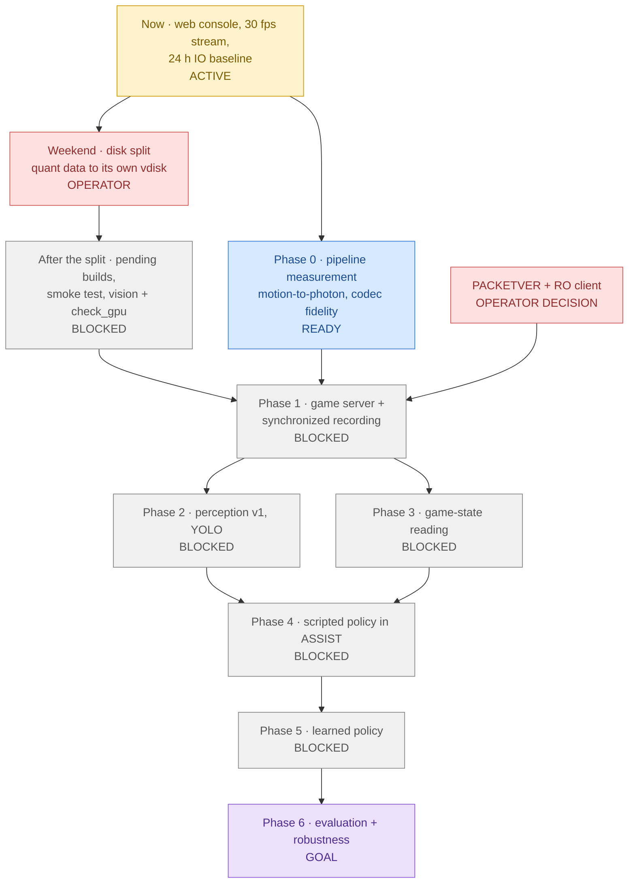

# poring-lab roadmap

## At a glance

| Step | Status | What it is | Blocker |
|---|---|---|---|
| **Now** | 🟡 ACTIVE | Web console on `frontend-dev` (tmpfs, no image builds), and the stream fixed at 30 fps (WebSocket deflate off, deadline pacing). A 24 h IO baseline is recording to `data/metrics/`. | Operator's manual check: view, click, type, toolbar keys |
| **Weekend · disk split** | 🟥 OPERATOR | Move the quant Postgres/Mongo data to its own Proxmox vdisk. The window is picked from the 24 h baseline. | Operator, weekend |
| **After the split** | ⬜ BLOCKED | Build rathena, the production frontend and vision; pull db; run `scripts/smoke_test.sh` and `check_gpu.py` (sm_120). | Needs the disk split: on the shared disk, builds pushed the capture Postgres past 25% IO stall (2026-09-29) |
| **PACKETVER + RO client** | 🟥 OPERATOR | Which client executable date (PACKETVER), and renewal or pre-renewal. Defaults: 20211103, renewal. | Operator decision; deferred |
| **Phase 0** | 🔵 READY | Motion-to-photon latency, RDP codec fidelity/fps (`RDP_GFX`), and capture budget. Needs only desktop + backend, which are running. | None technically. Sequenced after the builds by choice. The grab rate inside the vision container waits for the vision image. |
| **Phase 1** | ⬜ BLOCKED | rAthena + the matching client on Windows. Record synchronized frames + human input logs (+ server logs, offline sniffer). | Needs ALL of: rathena image (after the split), the codec choice from Phase 0 (recordings should use it), and the PACKETVER decision |
| **Phase 2** | ⬜ BLOCKED | Perception v1: YOLO on recorded frames, scored against server-log / sniffer ground truth (offline only). | Phase 1 data (and the vision image, via the split) |
| **Phase 3** | ⬜ BLOCKED | Game-state reading from pixels: HP/SP, status, minimap, position. | Phase 1 data; independent of Phase 2 |
| **Phase 4** | ⬜ BLOCKED | Scripted policy in ASSIST mode (the human can always take over); logged interventions. | Needs BOTH Phase 2 and Phase 3 |
| **Phase 5** | ⬜ BLOCKED | Learned policy: imitation from the human input logs; the scripted policy is the baseline. | Phase 4 as baseline |
| **Phase 6** | 🟪 GOAL | Long-run evaluation and robustness, including a replay Env for offline regression. | Phase 5 |

**The real bottlenecks are the SHARED DISK and OPERATOR DECISIONS.**
- Every image build or pull waits for the weekend disk split.
- Phase 1 also waits on the PACKETVER/client decision.
- Nothing technical blocks Phase 0 today; it comes after the builds only by choice.

## Ordered plan

1. **Now** — web console, fps fix, 24 h baseline (2026-09-29).
2. **Weekend** — disk split (operator).
3. **After the split:**
   - guarded builds (`scripts/guarded_build.py`): rathena, frontend, `pull:db`, `up`;
   - `scripts/smoke_test.sh`;
   - the vision build, then `check_gpu.py`.
4. **Phase 0 measurements** — motion-to-photon, and codec fidelity per `RDP_GFX` (autodetect / progressive /
   lossless legacy).
5. **Phases 1 → 6** as the graph allows.

## Phases (proposed — adjust as the research sharpens)

| Phase | Scope | Exit gate |
|---|---|---|
| 0 · Pipeline measurement | Stream/agent fps; motion-to-photon (a mux-injected key toggles a large UI element; time to the first changed pixel, on one host clock); codec fidelity vs a lossless on-Windows screenshot (SSIM/PSNR on UI text) | Numbers recorded; codec chosen |
| 1 · Server + recording | rAthena with the client's PACKETVER; synchronized recording of frames + input JSONL (+ rAthena logs, offline pcaps) | N hours of clean, synchronized sessions |
| 2 · Perception v1 | YOLO detection (monsters, players, items, UI) | Precision/recall vs ground truth, above an agreed bar |
| 3 · Game state | HP/SP, status, minimap, position from pixels | Accuracy vs server logs |
| 4 · Scripted policy | Farm loop in ASSIST; the human lease handles interventions | Stable multi-hour run; interventions logged |
| 5 · Learned policy | Imitation from input logs (RL later) | Beats the scripted baseline on agreed metrics |
| 6 · Evaluation | Long runs, robustness, replay-env regression suite | Reproducible evaluation report |

Hard rule throughout: pixels in, mouse/keyboard out. Packet and server-log data are only ever *offline*
ground truth, never agent input (see `CLAUDE.md`).

## Maintenance

This is a **living document**. Any task that closes or materially advances an item here must update the
at-a-glance diagram, the status table and `last_reviewed` in the same change, not later.
