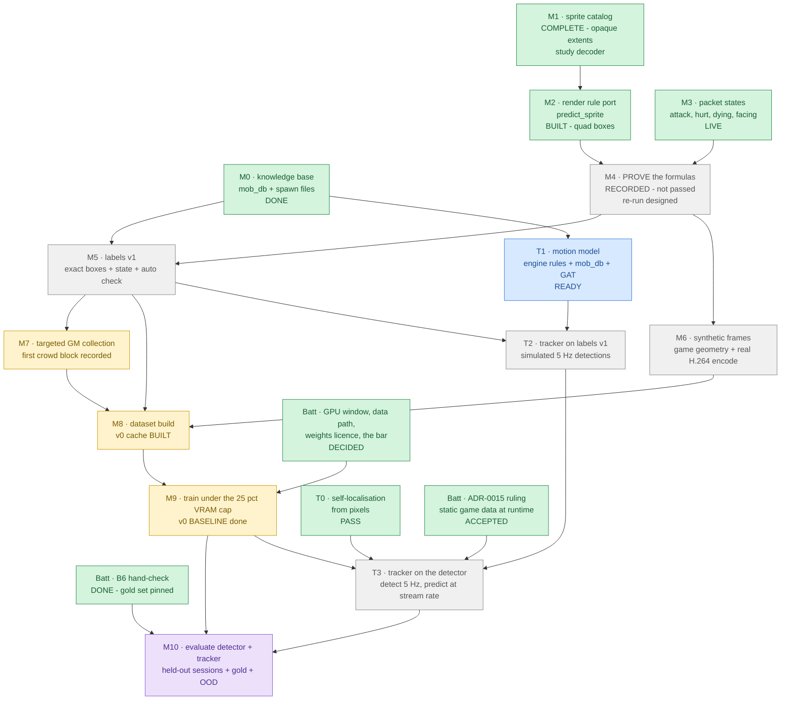

# Phase 3: perception. Compute what is deterministic, learn only the rest

**Status:** ~~PROPOSED 2026-10-04. This is a **plan only**: nothing in it is built, and Phase 3 does not start
until Batt approves it (§9).~~ ➡️ **APPROVED 2026-10-04 (Batt), with his §9 decisions:**
1. the plan, the order and the classes (per-species + dying; self computed);
2. one ~60 min S2 session for M4;
3. light GPU work now, heavy training 20:00–05:00 ICT, under the 25 % cap;
4. vision reads the NAS read-only, and the frame cache is sharded;
5. ultralytics is used (ADR-0018: vision is AGPL-3.0);
6. the bar as proposed;
7. the Roboflow set, test-only;
8. the GM gets `@alive`/`@heal`, and the driver never clicks a monster;
9. the ADR-0015 runtime ruling is ACCEPTED.

**Sources:**
- Batt's Phase 3 items (2026-10-04):
  - the classes;
  - a dataset build split BY SESSION;
  - a model under the 25 % VRAM cap;
  - evaluation against the auto-labels, against the hand-check (`label_iou`), and against the
    Roboflow RO set (CC BY 4.0) as a test-only out-of-distribution set;
  - risks;
  - what needs Batt.
- His data-collection note:
  - a sprite catalog first, as the coverage checklist;
  - classes from mob_db plus the spawn files;
  - a GM-controlled collection protocol, with STATE labels from packets, including dead/dying;
  - coverage per class × action × direction;
  - the split by session;
  - synthetic frames later, as optional augmentation.
- **His correction, which reshapes the plan:** "on-screen SCALE is game mechanics, not something to
  learn".
  - The client draws every sprite as a camera-facing billboard at the actor's world position, so
    its position, size, facing and animation frame are computable.
  - **Math for everything deterministic. GM spawns only to PROVE the formulas. Training only on what
    math cannot model:** occlusion and overlap, H.264 artefacts, skill effects, other players.

Hard rules that bind every step below:
- **Pixels in, mouse and keyboard out.** Packets are labels and ground truth OFFLINE, never an input at
  decision time (rule 1, ADR-0007).
- **Client-derived data never leaves the lab.** That covers SPR/ACT, GAT and synthetic frames rendered
  from them. They are generated at run time into `/dev/shm`, `data/` or the NAS dataset sink, and
  never committed (rule 4).
- **rAthena-derived knowledge-base data** (mob_db, spawns) is generated locally and never committed
  (GPL; rule 4).
- **Ports:** permissive code is ported with attribution in `THIRD_PARTY.md`.

## 0. At a glance

| Step | Status | What it is | Blocker |
|---|---|---|---|
| **M0** knowledge base | ✅ DONE 2026-10-04 | `scripts/kb_build.py` → `data/kb/` (gitignored): pre-re mobs, mob skills, spawns, warps, classes. prt_fild08 = Poring 70, Lunatic 40, Pupa 20, Drops 10 + **Creamy = Pupa's NPC_METAMORPHOSIS** (val1 1018; the packets show the same gid). Walk speeds: Poring 400, Lunatic 200, Drops 400, Creamy 150 ms/cell. The gate to prontera: (170,378) span 3×2 | — |
| **M1** sprite catalog | ✅ COMPLETE 2026-10-05 (study decoder; ~~PARTIAL 2026-10-04~~) | SPR/ACT parsers ported from nostalro (`sprites.py`), `scripts/sprite_catalog.py` → `data/kb/sprite_catalog.json`. **ACTs only:** every monster SPR in the Thai `data.grf` is **MIXCRYPT** (refused, the C8 stop). The ACT 2.5 species (Poring, Drops, Lunatic) have quad sizes (Poring idle 37×36 native); the ACT 2.4 ones have frames and delays only ➡️ **2026-10-05: COMPLETE (study decoder, Batt's option (a)).** All 12 species: ACT + SPR 2.1 decoded, OPAQUE extents per action × direction × frame (`data/kb/sprite_catalog.json`, local). Verified three ways: every decoded entry inflates to the table's size with the right magic; the SPRs parse; 2,336 + 1,572 + 2,336 ACT 2.5 layer sizes equal the SPR image sizes (0 mismatches). The decoder is host-local, never committed (THIRD_PARTY.md, korangar row) | **Batt:** (a) a MIXCRYPT decoder from the public spec, (b) another GRF (the lab's kRO one is on Windows only), or (c) quad boxes only |
| **M2** render rule | ✅ BUILT 2026-10-04 | `render.py` `predict_sprite`: f/z × k billboard, the ACT quad/opaque boxes, direction, the frame by time or distance. `box_kind` quad (ACT 2.5) or opaque (SPR); it raises rather than guess when sizes are missing | opaque boxes wait for M1's SPR pixels |
| **M3** packet states | ✅ BUILT + LIVE 2026-10-04 | `poring_packets` decodes the ZC_NOTIFY_ACT family (0x008A/0x02E1/0x08C8) and ZC_CHANGE_DIRECTION (0x009C); `world.py` keeps the vanish reason (died → `dying`), swings and flinches; `Timeline.state(gid, t)` = idle/walk/**attacking**/hurt/dying/sit + facing. The value is `attacking`, not `attack`: the locale guard (ADR-0012) refuses the bare word. The sniffer was rebuilt and recreated at 21:09 (live). `DEFAULT_DIE_MS` 2000 is a placeholder until M1 gives per-class die durations. ➡️ **All 20 NAS sessions were re-decoded the same night** (`scripts/replay_states.py`: the banked captures replayed in the sniffer, windowed and pseudonymised like the recorder) into a verified sidecar `packets.states.jsonl.gz` (0 original entities missing; 251 act events). **Real-data check:** a Poring's swing carries src_speed 672 and a Poring hit by the GM dmotion 480 -- mob_db's AttackMotion/DamageMotion exactly | the client-side attack facing is an assumption that M4 checks |
| **M4** prove it | 🟥 RECORDED, NOT PASSED 2026-10-05 00:03 ➡️ **RE-RUN 2026-10-05 21:45 (§5b): NOT PASSED** -- perspective right, a per-species vertical term missing | GM spawns near/far, indoor/outdoor, judged against pre-registered thresholds (§5). ~~BLOCKED 22:00 (to-console)~~ ➡️ both causes were lab-side and fixed (§ bottlenecks). **The session ran without Batt** (`20261004T233309-console-p3-m4`, 56,060 frames, 30/30 spawns, 0 GM failures; shipped + `dataset_check`). `m4_validate`: 1,893 standing frames, all QUAD boxes (SPR MIXCRYPT), so IoU/edges and k are NOT COMPARABLE; outdoor top third NOT EVALUABLE (`@monster` spawns around the GM: no top-third spawn); indoor top/bottom 1.395 and indoor/outdoor 0.878: FAIL. **The A/A disagrees by 5.7 %, more than the 3 % tolerance**, so the results section (§5) explains the failures: species mix, occlusion, a merged component. Thresholds unchanged | ~~Batt: MIXCRYPT a/b/c~~ ➡️ decided (a), study only, 2026-10-05: opaque boxes exist (M1). Re-scoring THIS recording needs the Thai-vs-kRO sprite check first (the Thai-data experiment, 3d) ➡️ **done 2026-10-05: the 12 KB species' SPR+ACT are byte-identical to kRO, so the opaque boxes from the Thai decode ARE the kRO client's sprites**; a fresh session with per-species groups, far spawns and an occluder-free indoor scene |
| **M5** labels v1 | ⬜ BLOCKED | predicted boxes + state + facing, and the automatic label check | M0 + M4 passed ➡️ M4 did not pass (2026-10-05) |
| **M6** synthetic | ⬜ BLOCKED | sprites rendered with the game's geometry onto real backgrounds, then a real H.264 encode | M4 passed |
| **M7** collection | 🟡 FIRST CROWD BLOCK 2026-10-05 | GM sessions only for what math cannot make. ➡️ In the M4 room's spare time: `20261005T000655-console-p3-m7-crowd` (18,703 frames; outdoor + indoor, 8 × `@monster <species> 8`, Poring + Lunatic, 0 GM failures): occlusion/crowd frames. M4's 30 `@killmonster2` kills are also 30 dying-animation windows | M5 (coverage tracking) |
| **M8** dataset | 🟡 v0 BUILT 2026-10-04 | `scripts/build_frame_cache.py` → tar shards on the NAS (`.framecache/`), one sequential pass per session, split by session, the gold set test only. v1 waits for M5 | M5 + M6 + M7 for v1 |
| **M9** train | 🟡 PIPELINE PROVEN 2026-10-04 | `poring_vision.train` reads the shards in place (vision mounts the NAS read-only); `rundev:vision` iterates without an image rebuild. Smoke (v0, 400/100 frames, 3 epochs): mAP50 0.795, peak VRAM 2,216 / 3,962 MiB, Frigate inference +5 ms mean during. Tonight: a v0 BASELINE, because v1 is blocked (M4) ➡️ **v0 BASELINE DONE 2026-10-05 04:44** (YOLO11n 1280, 30 epochs, batch 4; 22:33-23:27 + 00:22-04:44, paused for the M4 room after epoch 5 and resumed). Val (outdoor-c + indoor-a): mAP50 0.818, mAP50-95 0.691. **Held-out test:** indoor-c 0.761 / 0.562; s2-outdoor 054429 **0.525** / 0.455 (monster AP50 0.448: a cross-session gap); indoor-v2 0.776 / 0.549 (against v0 AUTO labels: the hand-check was never saved). 4.5-5.1 ms/image, peak VRAM 2,510 / 3,962 MiB in training. Labelled BASELINE: never judged against the bar (v0 labels predate the AID fix). Frigate inference 28.9 → 36.3 ms mean while training; quant-postgres worst 10 s bin 9.38 %. Numbers in `data/bench/train/` (local) | v1 labels (M5) |
| **T0** self-localisation | ✅ PASS 2026-10-04 | the minimap's coordinate readout (`poring_env.selfpos`, anchor `minimap_xy`), digit templates cut from frames (local, gitignored). Held-out, pre-registered: standing 99.36 % exact (2,320/2,335), walking 99.70 % within 1 cell, 0 wrong reads; A/A both halves pass. outdoor-c alone is 98.70 %: loading screens past the 3 s exclusion, not moved. **No minimap indoors** (prt_church): there T0 needs a fallback (walk commands, ground registration). `walk.py`'s path limit is now 32 (the pinned server's buffer; walk_check: 9,636/9,636 walks found, the longest 14 steps) | — |
| **T1** motion model | ⬜ BLOCKED | the engine's movement rules (§6b) + mob_db speeds + GAT walkability, as a predictor | M0 |
| **T2** tracker, simulated | ⬜ BLOCKED | predict → associate → update in WORLD cells, fed labels v1 thinned to 5 Hz with drops and noise | T1 + M5 |
| **T3** tracker, real | ⬜ BLOCKED | the same on the detector's output; YOLO ~5 Hz, prediction at stream rate | T2 + M9 + T0 + the ADR-0015 ruling |
| **M10** evaluate | 🟪 GOAL | detector: held-out sessions, Batt's gold set, the Roboflow set (OOD). Tracker: against packets (§6b) | M9 + T3 + the B6 hand-check ➡️ ~~**NOT SAVED (2026-10-04 22:55):** `/qa` opened on the newest session, p3-indoor-c, so the review covered that run; indoor-v2's frames were never fetched and no hand-check file exists. Redo: `http://192.168.1.13:3000/qa?session=20261004T103815-console-s2-indoor-v2`, **A** on each of 27 frames (→ saves)~~ ➡️ **DONE 2026-10-05 13:32-13:38** (27/27 frames, 154 boxes; sha256 `e3e68082…6aa0`, pinned on the NAS). v0 auto-labels vs it, IoU 0.5: monster P 0.644 / R 0.580 / mean IoU 0.901; npc P 0.833 / R 0.833 / 0.979; overall P 0.715 / R 0.669 / 0.935: the v0 baseline labels v1 must beat |

**The real bottlenecks:**
- ➡️ **2026-10-04 22:00: the Windows console.** M4's session could not start: `to-console` stalls
  intermittently, and once through, the console showed the Windows sign-in screen, not the
  poring-lab session. ~~Batt's side (the console session / tscon)~~ ➡️ SPLIT 23:00:
  - **the stall was LAB-SIDE and is FIXED** (`ro_agent.ensure_window` + `AGENT_WS`): right after
    capture_backend re-opened its desktop window for the new lock SEQ, `ro_agent` asked `/health`,
    which reports the interlock as of its last 1 Hz tick and still said "no window". It ran
    `capture_backend.py window`, which waited its 30 s `--wait-lock` for the flock its own parent
    held, then failed; the agent socket, unread for that long, then hung its 10 s close (the
    library's receive flow control stops reading after 16 queued messages). 30 + 10 + ~2 s = the
    observed 42 s (21:42:52 → 21:43:34). It hit 3 of 4 runs: it depends on where the tick falls.
    Now the window is read fresh from the host file with the backend's own parser, and the socket
    has no receive flow control (tests reproduce both, control arm included);
  - ~~**the sign-in screen stays Batt's side**~~ ➡️ **ALSO LAB-SIDE, FIXED 23:16** (589fc39): the
    agent's shell sat at a `>>` prompt -- an earlier long line (close-extra-shells) had been cut
    off with an unclosed `{` -- so the typed tscon line was appended and never ran (the task's
    LastRunTime is still 13:02:14, result 0). A stale green bar passed three elevation checks
    meanwhile. Now every console line goes through `type_line`: Escape first (drops pending
    input, verified live), then a fresh-width proof bar it waits for. And `m4_spawns
    --check-client` gates the recorder (33d131e): nothing is recorded unless the client is on
    the stream. Windows needed nothing.
- ➡️ **Label truth, found by T0:** (1) FIXED: the Timeline looked maps up as `x.gat`, so walks
  fell back to a straight path; (2) ~~OPEN: our own block id (AID) is unknown in recorded sessions
  (no login_accepted after the last map change), so our own entity_stop is ignored.~~ ➡️ FIXED the
  same night: the Timeline infers it (`timeline.infer_self_aid`, from T0's truth). Measured on the
  baseline's sessions: 2-7 of our own stops per session had been ignored (of 9-121 walks), each
  shifting every box until our next walk, so roughly 1-3 % of those frames. The **v0 baseline cache
  (v0-baseline-20261004b) predates this fix** and carries that error; v1 will not.
- ➡️ **2026-10-04: the SPR pixels.** Every monster SPR in the Thai GRF is MIXCRYPT (M1). Exact
  opaque boxes (k in M4), the label check (M5) and synthetic frames (M6) need them; Batt decides how
  to get them. M4's spawns are recorded regardless, and re-analysed when pixels exist.
- **M4**, the one S2 session that proves or refutes the render rule. Every label, the label check
  and the synthetic data depend on it.
- **Batt's decisions** (§9), including the ADR-0015 ruling that lets perception use static game data
  at runtime (the tracker's motion model needs it).

M0, M1 and M3 are offline and independent, so they run in parallel the moment the plan is approved.

## 1. The principle: what is computed, what is learned

| Quantity | Source | Learned? |
|---|---|---|
| Where an actor stands (cell, sub-cell while walking) | packets: appear, move, stop (offline labels only) | no |
| Its on-screen anchor | the fitted camera + the map's GAT altitude (Phase 2, B4) | no |
| Its on-screen **size** | billboard rule: `px_per_world_unit(depth) × k × sprite px` (§3) | **no** (Batt's correction) |
| Facing (one of 8) | the packet heading + walk vector, relative to the camera yaw (act.rs:568-570, already ported in `camera.py`) | no |
| Action and frame | the packet state (M3) + ACT timing (24 ms units; the walk cycle is tied to distance walked) | no |
| The exact sprite pixels of that frame | SPR/ACT (M1) | no |
| **Occlusion** (map geometry, other sprites), overlap in crowds | the scene | **yes** (real frames) |
| **H.264 artefacts** at the stream's bitrate | QuickSync on Windows | **yes** (real frames + real encode of synthetic frames) |
| **Skill and hit effects**, damage numbers, other players | the scene | **yes** |

At decision time the model sees pixels only. Everything in the "no" rows is used to make
**labels**, **checks** and **synthetic frames**, never as a runtime input.

## 2. Facts this plan stands on

**The sessions so far (Phase 2, S2):**
- Porings 1002 dominate. Lunatic 1063, Pupa 1008, Drops 1113 and Creamy 1018 are rare.
- About 15 fixed NPCs; portals are job 45.
- **Zero other players:** one Windows session means one client.
- The v0 labels use **one constant box per class** (`labels.py BOX_PX`: monster 44×40 px), whatever
  the depth or the map.

**The fitted camera** (`camera_console.json`):
- outdoor: pitch 44.44°, distance 400.2, FOV 15°, f = 2,734.5 px;
- indoor (prt_church, from the client's `indoorrswtable`): yaw +45.96°, distance 273, pitch and FOV
  unchanged;
- Byalan (`iz_dun*`) is **not** in the indoor table, so it uses the default camera.

**The render rule, found in the license-checked clients:**
- **nostalro-client @15b3029 (Apache-2.0):**
  - `lib/renderer/src/sprite_projection.rs:150-177` `project_entity_screen`: the anchor is
    `cell_to_world(x+0.5, y+0.5)` at the cell's GAT height;
  - `sprite_scale = camera.perspective_scale(anchor) × zoom / 75`;
  - `lib/renderer/src/camera.rs:425-432` `perspective_scale` = `proj[1][1] / clip.w × screen_h / 2`,
    the pixels per world unit at that depth;
  - `lib/formats/src/map_coordinates.rs:41-47`: a GAT cell is half a GND tile;
  - `lib/renderer/src/sprite.rs:~866-952` `build_clip_quad(_scaled)`: each ACT layer's quad is centred
    at `anchor + (clip.x, clip.y)`, sized `w×zoom_x`, `h×zoom_y`, rotated by `angle`, with the U
    coordinates swapped when `mirror` is set; the quad is then scaled about the anchor by
    `sprite_scale`;
  - `lib/formats/src/act.rs:8-12` `FRAME_DELAY_UNIT_MS = 24`;
  - `act.rs:620-633`: the walk animation advances with **distance walked**
    (`delay/24/7.4` cells per frame);
  - `act.rs:568-570`: action index = `action×8 + (camera_dir + 12 − dir) % 8`.
- **korangar @e14d320 (MIT):**
  - `korangar/src/world/animation/mod.rs:15-16,287-302`: the billboard size is
    `frame px × SPRITE_SCALE(1.4) / TILE_SIZE(10)` world units, its origin `−offset.y + 0.5` px below
    the anchor;
  - `korangar/src/world/cameras/mod.rs:47-67` `billboard_matrix`;
  - `korangar/src/loaders/map/mod.rs:31-32`: a GAT cell is 5 world units;
  - `world/animation/mod.rs:40-60`: monster ACT actions are idle 0, walk 1, attack 2, hurt 3, die 4,
    × 8 directions.

**The two clients disagree on the one constant `k` (world units per sprite pixel):**
- nostalro: `zoom/75` = **0.1333** (GND zoom 10, to be confirmed at port time);
- korangar: `1.4/10` = **0.140**.

That is 5 %, or about 2 px on a Poring. M4 decides between them by measurement, not by choice.

**What the rule predicts with our camera** (a billboard's size is `f/z × k × px`; `z` is the depth of
its anchor):

| Scene | Screen top | Centre | Bottom |
|---|---|---|---|
| outdoor, px per world unit | 5.93 | 6.83 | 7.73 |
| outdoor, × native sprite size (k = 0.1333 / 0.140) | 0.79 / 0.83 | 0.91 / 0.96 | 1.03 / 1.08 |
| indoor, × native sprite size | 1.17 / 1.23 | 1.34 / 1.40 | 1.49 / 1.57 |

The same monster therefore spans **0.79× to 1.49×** across what we already record, a 1.9× range that
the v0 constant box ignores. Indoor/outdoor at the centre is 400.2/273 = **1.466×**.

**The spawn tables.** The lab server is **pre-renewal** (`RATHENA_PRERE=yes`; ADR-0015's KB reads
`db/pre-re` and `npc/pre-re/mobs`). These are from rAthena @e985006, `npc/pre-re/mobs/`, read for
facts and never committed:

| Map | Species (spawn slots) |
|---|---|
| prt_fild08 | Poring 1002 (70), Lunatic 1063 (40), Pupa 1008 (20), Drops 1113 (10) |
| iz_dun00 (Byalan F1) | Plankton 1161 (65), Marina 1141 (45), Hydra 1068 (15), Kukre 1070 (15), Vadon 1066 (15), Black Mushroom 1084 (5) |
| iz_dun01 (Byalan F2) | Vadon 1066 (60), Kukre 1070 (50), Hydra 1068 (30), Cornutus 1067 (15), Marina 1141 (15), Black Mushroom 1084 (10), Plankton 1161 (10) |

This matches what our sessions saw on prt_fild08 (Poring, Lunatic, Pupa, Drops). Creamy 1018, also
seen, is in no prt_fild08 spawn line; its source (a GM test, a neighbouring map) is checked in M0.

*(The first draft of this table, 2026-10-04, quoted `npc/re/mobs/`: Fabre and Little Poring, which
this server never spawns.)*

**Reading H.264 offline** ([h264-vs-png.md](benchmarks/h264-vs-png.md), 2026-10-04):
- random single-frame access is expensive on this loaded host (decode ~12.6 ms per AU with 2 threads,
  BGRA 2.5 ms, checksum 9 ms);
- **so training never seeks**: one sequential pass per session builds a frame cache (M8).

**The packet decoder** (`poring_packets`, first slice):
- decoded: appear (new, stand, move, with the heading), move, stop, vanish (with its reason byte),
  map change, chat, stats;
- **missing for states:** the action/damage packet (attack, hurt and its target) and the direction
  change.

**Vision:**
- torch 2.14 cu130, ultralytics 8.4.165 (**AGPL-3.0, not yet in THIRD_PARTY.md**);
- `mem_limit` 6g;
- VRAM cap 25 %, which is **3,962 MiB** on the RTX 5060 Ti;
- the agent network only, with no NAS mount;
- the `YoloDetector` stub expects `/data/weights`.

## 3. The render rule, as we will port it

For an actor at cell `(x, y)` on map `m` at time `t`:

1. **Position.** The anchor is `(x+0.5, y+0.5)`, or the interpolated walk position while moving
   (`Walk.position_at`, Phase 2). Its world point is `(x·5, gat_height, y·5)`, projected with the
   fitted camera (outdoor, or the indoor rule for maps in `indoorrswtable`).
2. **Scale.** `s = (f / z_anchor) × k`, where `k` is the single constant M4 measures (prior 0.1333 or
   0.140). Nothing per map, per class or per screen region is fitted: the perspective term carries
   all of it.
3. **Action and direction.**
   - The action comes from the M3 state: idle 0, walk 1, attack 2, hurt 3, die 4.
   - The direction is `(camera_dir + 12 − dir) % 8` (already ported).
   - The frame comes from the 24 ms ACT delays: walk by distance walked; attack scaled to the
     packet's attack motion time; hurt and die from their start events.
4. **Pixels.** Each ACT layer of that frame: an SPR image at `anchor + (clip.x, clip.y)`, `zoom_x/y`,
   `angle`, `mirror`; the whole sprite then scaled about the anchor by `s`.
5. **The box** is the opaque pixels' extent (alpha > 0) of the composed sprite.
   - Monsters' ground shadow is a separate decal and is not part of the box.
   - When the frame phase is uncertain (an idle loop whose start we did not see), the box is the
     **envelope**, the union over that action's frames, and the label says so.

`predict_sprite(actor, map, t) -> {box, anchor_px, scale, action, direction, frame, phase_known,
mask}` lives in `poring_dataset` (host side, like the reader). The SPR/ACT parser is our own code,
ported from the Apache/MIT sources above, with THIRD_PARTY entries added in the same commit as the
port.

## 4. Classes

**v1, from M0 and Batt's correction:**

| Class | Labels from | Why it is a class |
|---|---|---|
| one class per prt_fild08 species: `poring`, `lunatic`, `pupa`, `drops` | M5 (math) + M6 (synthetic, unlimited per species) | The bot needs to know WHAT it targets. Synthetic data removes the rarity problem that forced `monster_other` in the earlier draft. |
| `dying` (any species, during its die animation) | M3: vanish reason = died, then the die action's duration | **Never target corpses** (Batt). Species does not matter here; "not a target" does. |
| `npc` | M5: NPC position (rAthena script, static) + its sprite | Static, but the detector should still see and avoid it. |
| `portal` | job 45 at its cell; a ground effect with its own geometry | |

**Not learned, by the same principle:**
- `self`: the camera follows the player, so its feet are the camera target `(cx, cy)` (Phase 2's fit).
  It is kept as an evaluation label and **not trained**, unless M10 shows the detector needs it to
  separate self from overlaps. That is Batt's call (§9).
- `other_player`: defined, but no data while one Windows session means one client. Deferred.

**v1.1:**
- Byalan F1-F2 species (§2) after their own M4 spot-check (a different map; the default camera).
- Facing and action as **attributes**, from a small crop classifier trained on M5/M6 labels. The v1
  detector does not need them; the planner may (ADR-0015).

The B5 rules (hidden NPCs, UI cover, GM windows) apply unchanged.

## 5. M4: proving the formulas (pre-registered)

**Protocol.** One S2 session on the lab rAthena: interlock green, ASSIST, hard cap absolute.
1. `@killmonster2`; the GM stands still. A 5 s **background** clip is recorded.
2. `@monster <species> 1` per spawn. The packet gives its cell.
3. Frames where it **stands** (no walk active, more than 1 s after any stop) are kept.
4. The **observed box** is the tight extent of changed pixels against the background: per-channel
   difference > 24, a 1 px morphological open, and the component that contains the predicted anchor.
   A frame where any other change touches the window is excluded.

   This measurement is independent of the predictor.

**Conditions:**
- outdoor top third, outdoor bottom third, indoor top third, indoor bottom third;
- at least 5 distinct spawns and at least 20 standing frames per condition;
- Poring, plus one other prt_fild08 species (Lunatic or Drops) outdoor.

**Pre-registered expectations:**

| Check | Pass |
|---|---|
| `k`, fitted as ONE scalar over all conditions | within 2 % of 0.1333 (nostalro) or 0.140 (korangar). Within neither: the rule is incomplete; find the missing term in the source, do not tune. |
| Box IoU, predicted (envelope) vs observed, per condition | median ≥ 0.85, p10 ≥ 0.70 |
| Edge error, each of the four edges, per condition | median ≤ 2 px, p95 ≤ 4 px |
| Perspective: the top-third vs bottom-third size ratio | within 3 % of the predicted ratio (outdoor 0.79/1.03 = 0.77 at the screen extremes; evaluated at the actual rows) |
| Indoor vs outdoor size at matched rows | within 3 % of the predicted ratio (1.466 at the centre) |
| Moving monsters | REPORTED, not gated (Phase 2's timing tail) |

**A failure is a finding:** record it, explain it, and re-run on a fresh set, one variable at a time.
The thresholds are never moved after the data is seen.

### 5a. Results, 2026-10-05 (the pre-registration above is unchanged)

Session `20261004T233309-console-p3-m4` (S2, H.264, without Batt), events
`/dev/shm/.../m4/events.jsonl` (copied into the bench JSON's folder, `data/bench/m4/`, local only).
`m4_validate.py` measured 1,893 standing frames (every 5th frame; deterministic: a re-run gave the
identical summary).

| Check | Result | Verdict |
|---|---|---|
| `k` | not fittable from QUAD boxes (transparent margins) | NOT EVALUABLE until opaque boxes |
| IoU / edges | outdoor centre 0.821 / p10 0.73, edges 1.18 / 4.43 px; other groups worse | NOT COMPARABLE (quad) |
| Outdoor top vs bottom | no spawn landed in the top third | NOT EVALUABLE |
| Indoor top vs bottom | ratio of ratios 1.395 | FAIL |
| Indoor vs outdoor (centre) | 0.878 | FAIL |
| A/A (outdoor-1 vs outdoor-2) | ratio_h 0.881 vs 0.931: 5.7 % apart | the instrument does not resolve 3 % |

**Diagnosis (one variable at a time; not a re-scoring):**
1. **Species mix.** A quad's transparent margin differs per species. ratio_h outdoors is 0.854 for
   Poring and 0.969 for Lunatic, and a group's median depends on its species mix. outdoor-2 had more
   Lunatic frames. Per species the A/A agrees: Poring bottom 0.8502 vs 0.8533 (0.4 %), Lunatic
   centre 0.9961 vs 0.9839 (1.2 %). The "constant margin cancels" assumption holds only within one
   species, so every ratio test must be per species.
2. **Occlusion indoors.** prt_church's pews cover sprites. Indoor bottom is 45 Poring frames at
   ratio_h 0.63, IoU 0.52, edge median 9 px. Background differencing assumes no occluder.
3. **A merged component.** outdoor-2 bottom Poring has ratio_w 2.94 at IoU 0.31: the observed
   component joined something wider. These frames need an exclusion rule.
4. **No far spawns.** `@monster` spawns around the GM, so the top third never fills.

**Re-scored 2026-10-05 with OPAQUE boxes** (`m4_validate.py --opaque`: the Thai SPRs decoded by
the MIXCRYPT study decoder; the same recording, the kRO client; diagnostic, no verdict: the re-run
waits for the Thai-data decision). Lunatic: the Thai sprite matches the kRO render (outdoor centre
IoU 0.82, edges 1.1-1.2 px, size ratio 1.06 h / 0.97 w). Poring: widths match (1.00-1.07),
heights 0.85: the predicted box is the ENVELOPE of the bouncing idle loop (phase unknown), taller
than any one frame. Outdoor centre passes the edge test (1.24 / 3.64 px) and misses IoU narrowly
(0.819 vs 0.85). The confounds above are unchanged (indoor bottom 0.52; the merged component).

**Re-run design (Batt decides; nothing re-run yet):**
- (a) the MIXCRYPT decision → opaque boxes re-score THIS recording for IoU/edges/k;
- (b) a fresh session with:
  - per-species groups;
  - far spawns (the GM moves away after spawning, or spawns at range);
  - an occluder-free indoor scene;
  - the exclusion rule for merged components, written BEFORE the data is seen.

### 5b. The re-run, pre-registered 2026-10-05 ~19:30 ICT, BEFORE its session

Batt approved the §5a design on 2026-10-05: the kRO client, the main rathena, one fresh session.
It changes several variables at once. The §5 thresholds are unchanged. Tooling:
`scripts/m4_cells.py` (the cells), `scripts/m4_spawns.py --spot/--cells` (far spawns) and
`scripts/m4_validate.py --opaque --rerun` (the analysis), all committed before the recording.

**Scenes.**
- Outdoor: `prt_fild08 268,107`, the open spot where the console camera was fitted (37 open cells
  each way). bench.py's 170,375 has no room north for a top-third spawn.
- Indoor: `prt_church 104,122`. Of 210 walkable GM spots scanned, it has the most occluder-free
  cells in both the top and the bottom third (22 and 9). At 99,112 the pews leave 2 top and 0
  bottom.

**Cells.** `m4_cells.py`, written to `data/bench/m4/cells.json`, uses the console camera and the
OPAQUE Poring idle envelope. A cell qualifies when:
- the predicted box is fully inside 1280x720 and covers no UI window;
- the anchor row lies in the condition's third (top < 240 <= centre < 480 <= bottom);
- the same holds for every walkable neighbour within 1 cell (spawn jitter, the random walk);
- indoor only: no non-walkable cell (pew or wall) lies IN FRONT of it, within 3 cells and
  overlapping the sprite's columns.

Candidates:
- outdoor: 160 top, 206 centre, 51 bottom;
- indoor: 24 top, 5 centre, 9 bottom.

**Blocks.** Each block is one scene and one third; inside a block the species run one after another
(`@killmonster2` between spawns).
- Outdoor: `outdoor-top`, `outdoor-centre`, `outdoor-bottom`, each 5 Poring + 5 Lunatic.
- Indoor: `indoor-top`, `indoor-centre`, `indoor-bottom`, each 5 Poring.
- Each spawn is FAR, at a pre-chosen cell of that third:
  1. `@warp` there (the same map, so the camera rotation is kept);
  2. `@monster <species> 1`;
  3. `@warp` back to the spot;
  4. then the measured window starts.
- `--hold 40`, `--background 5`. The GM never clicks a monster; `@heal`/`@alive` keep it alive.

**Analysis rules (`--rerun`):**
1. **Local background.** The background is the last background gap before the spawn. A frame counts
   only if the GM stands on the same cell as in that gap.
2. **Exclusions (frames are dropped and counted):**
   - the observed component touches the ROI border (±40 px) or the screen edge;
   - it covers a UI window;
   - its area is over 1.5x the predicted envelope's;
   - indoor: the monster's standing cell fails the occluder proxy above.

   These are on top of §5's: one entity of the species in view, idle for at least 1 s, no other
   actor's anchor within 120 px.
3. **Conditions** are scene / third / species. Each needs at least 5 spawns and at least 20 clean
   frames; otherwise it is NOT EVALUABLE, which is not a pass.
4. **Ratio tests run per species:**
   - top vs bottom, per scene;
   - indoor vs outdoor at the centre, for Poring;
   - each within 3 %.
5. **A/A.** Within each condition, the odd vs the even spawns: the median ratio_h within 3 %.
6. **k.** Per frame: the observed height divided by f/z, divided by the median native height of
   the species' idle frames in that direction (the unknown idle phase cancels in the medians). The
   median over all clean frames is the ONE scalar. It passes within 2 % of 0.1333 (nostalro) or
   0.140 (korangar); the one it lands on is the k used by M5. The width version is reported beside
   it, not gated.
7. IoU and edges per condition, as in §5.

**Verdict.** M4 PASSES only if every one of these holds:
- every condition is evaluable;
- IoU, edges and A/A pass in every condition;
- every ratio test passes;
- k passes.

Anything else is a FINDING: name the missing term; never tune.

#### 5b results, 2026-10-05 21:45 ICT: NOT PASSED (the pre-registration above is unchanged)

**Recordings.** Three recordings of the same protocol, analysed together (`m4_validate --opaque
--rerun --ncc --also`; `data/bench/m4/rerun.json`, rows in `rerun.rows.jsonl`, local):
- `20261005T195146-console-p3-m4-rerun`: outdoor top and centre. Its recorder was stopped at
  20:17:43 by the IO guard (a quant-postgres burst, 15-42 % for ~30 s; the lab's load was
  constant), so outdoor-bottom had only 3 Poring spawns and the indoor blocks none.
- `20261005T205425-console-p3-m4-rerun-ob` (outdoor bottom) and
  `20261005T210542-console-p3-m4-rerun-in` (indoor): re-recorded in a second clean room, one
  recording per block group.
- 45 + 25 spawns, 0 GM failures, 0 heals. 2,730 clean standing frames, all OPAQUE boxes.
- Excluded frames: 336 ui, 108 roi_edge, 3 merged_area, 21 without a background.

| Check (pre-registered) | Result |
|---|---|
| k, ONE scalar (height) | **0.1237: within neither prior** (nostalro -7.2 %, korangar -11.6 %). FAIL. The width version (reported, not gated) is 0.1421, korangar +1.5 % |
| IoU median >= 0.85, p10 >= 0.70 | FAIL in every condition. Best: outdoor/centre/poring 0.788 / 0.717 |
| Edges median <= 2 px, p95 <= 4 px | Outdoor medians 1.5-1.9 px (pass); outdoor p95 4.5-8.5 px (fail). Indoor fails (median 2.9-7.2 px) |
| Top vs bottom, per species | **PASS**: outdoor Poring 1.014, outdoor Lunatic 1.022, indoor Poring 0.987 |
| Indoor vs outdoor (Poring, centre) | 0.9675: FAIL by 0.25 points |
| A/A (odd vs even spawns) | Passes in 6 of 9 conditions. Fails: indoor/top/poring (0.363 vs 0.845: a broken half), outdoor/bottom/lunatic (3.7 %) |
| Evaluable | 8 of 9: outdoor/top/lunatic has 4 spawns (< 5) |

**The finding: the missing term is per SPECIES and VERTICAL.**
- The observed/predicted HEIGHT is stable within a species, across thirds, scenes and A/A halves:
  - Poring 0.83-0.87;
  - Lunatic 1.07-1.09.
- Widths agree (k from widths lands on korangar), and the perspective tests pass. So f/z and the
  camera are right; what differs is each species' vertical extent.
- **Located (21:50-22:05, diagnostic, no verdict change):** in both species the BOTTOM edge
  matches (Poring +0.8 px, Lunatic 0.0 px median), so the anchor and the projection are right. The
  whole miss is at the TOP:
  - Poring: the observed top is 5.0 px lower outdoors and 10.1 px lower indoors.
  - Lunatic: the observed top is 2.3 px higher.
- **Two different terms, seen on crops** (`/dev/shm/poring-lab-tmp/m4-rerun2/crops/`, local):
  1. **Poring: a MEASUREMENT artefact.** The predicted box includes the Poring's thin tuft on top,
     which the client draws. The observed box stops below it: the 1-px morphological opening
     deletes 1-2 px wide protrusions. Its idle frames are 33-39 native px tall; the observed median
     is 33.3, near the shortest frame, and p10 30.3 is below every frame.
  2. **Lunatic: a PREDICTION term.** The observed top includes the ears, drawn 2.5-4 native px
     higher than ANY frame our composer produces (frames 22-27 px; observed median 29.4, p90
     30.9). It points at a layer offset, or the frame/direction choice in `compose_frame`.
- **The next run, one variable at a time:**
  - first the measurement: keep thin structures, e.g. open only the low-contrast noise, or measure
    on the unopened mask with a minimum component size, decided before any re-score;
  - then the Lunatic composition (compare the ACT layer offsets with the drawn crop).
  - k is judged only after both are settled. The thresholds stay.
- Indoors, the edges are worse (p95 13-24 px), consistent with the indoor camera's larger fit error
  (spawn validation 11.5 / 21.7 px).
- tau (the label-check threshold) was measured: 0.092 (p5 of NCC over the clean rows; median
  0.425). It is NOT used: M5 waits for a passing M4.

**Next (Batt decides):**
- per-species crops (observed vs rendered) to separate (1) from (2), then one variable at a time;
- an indoor camera re-fit at 104,122;
- the thresholds stay.

## 6. M5–M7: using the rule

**M5, labels v1.** Every auto-label gets:
- `predict_sprite`'s box (exact frame when the phase is known, otherwise the envelope);
- the class from M0's mapping of mob ids to classes;
- the state, `idle|walk|attack|hurt|dying`, and the facing;
- a `label_check` score.

**The automatic label check (Batt's (b)).** Render the expected sprite (its mask and pixels) at the
predicted box and compare it with the observed crop: a masked normalised cross-correlation.
- **Threshold:** the 5th percentile of M4's clean standing examples, fixed before M5 runs.
- **A low score is classified as:**
  - `occluded`: another actor's predicted box overlaps it, or it is behind map geometry;
  - `ui_covered` (the B5 rule);
  - `bad_label`: a timing/offset error, or the client drew nothing.
- `occluded` frames are the ones worth training on. `bad_label` frames are dropped and counted.
- **Pre-registered:** `bad_label` < 2 % of standing labels on the M4 session, and reported per session
  after.

**M6, synthetic frames (Batt's (c), a major training source).**
1. **Backgrounds:** real frames from our recordings with no actor predicted in the area (after a
   `@killmonster2`, or regions M5 marks empty).
2. **Sprites:** M1's SPR/ACT, placed and scaled by `predict_sprite` at sampled cells, actions,
   directions and frames, depth-sorted far to near, with the shadow decal. Crowds are sampled on
   purpose, so sprite-on-sprite overlap is exact and labelled.
3. **A real H.264 encode** of the 1280×720 sequence: libx264 configured like the stream (4 slices,
   IDR 1 s, the measured ~5.5 Mbit/s), decoded with our reader.

   Sunshine encodes with QuickSync, so the encoder mismatch is a measured gap, not an assumption
   (M10).
4. **Labels are exact by construction.**

Synthetic frames are client-derived, so they stay in `/dev/shm`, `data/` or the NAS sink and are never
committed. They cannot model occlusion by map geometry (trees, walls). That is left to real frames.

**M7, targeted GM collection.** Real sessions only for what math cannot make:
- crowds: `@monster poring 10` in a small area;
- fights: attack, hurt, death, and the hit effects and damage numbers;
- occlusion behind trees and walls;
- the real QuickSync artefacts.

All of it is H.264 (the new default) with M5 labels.

**Coverage** is tracked per class × action × direction against M1's catalog. A cell counts as covered
by real frames, by synthetic frames, or both, reported separately. Collection stops when every cell
has its target (proposed: ≥ 200 real or ≥ 1,000 synthetic + 50 real).

## 6b. Tracking with the game's own motion rules (Batt, 2026-10-04)

**Principle.** Like H.264 motion vectors: units do not appear from nowhere; they come from where they
were.
- A few monsters can teleport; NPCs mostly stand still.
- **Occlusion and off-screen are handled by PREDICTION, not by training.** The detector finds what is
  visible; the tracker carries everything else.

**Tracks live in WORLD cells, not on the screen.**
- Each frame, our own cell (T0) and the fitted camera project every track onto the screen.
- NPCs and off-screen units persist in a world map (object permanence). A monster that walked off
  the edge is still there when the camera comes back.

**The motion model (T1) is the engine's rules, not a learned one.** We read rAthena @e985006 for
mechanics only: no GPL code goes into the deployable path, the same discipline as `walk.py`.
1. **Step timing.** A straight step takes `speed` ms; a diagonal takes `speed × 14 / 10`
   (`src/map/path.hpp`, `MOVE_COST 10` / `MOVE_DIAGONAL_COST 14`; `unit.cpp` walk timer). Our
   `Walk.position_at` (Phase 2, `poring_packets/world.py`) already interpolates this way.
2. **Paths.** 8-neighbour, no corner cutting, on the GAT's walkability (`walk.py`).
   - The pinned server's walk-path buffer is `MAX_WALKPATH 32` (`path.hpp`).
   - ~~⚠️ `walk.py` says 128 is "the server's path buffer". That disagrees with the pinned source and is
     to be reconciled in T1 (recorded, not changed here).~~ ➡️ Resolved 2026-10-04: `walk.py`'s
     `MAX_LEN` is 32 (path.cpp refuses `len > sizeof(wpd->path)`); no recorded walk exceeds 14 steps.
3. **The random walk** (`mob.cpp` `mob_randomwalk`):
   - a target drawn uniformly within ±7 cells (a 15×15 box), passable and reachable;
   - the next walk is due **4.0–5.0 s after the previous walk ENDS**
     (`MIN_RANDOMWALKTIME 4000 + rnd()%1000 + the path time`).

   So a wandering monster walks a short straight/diagonal path, stands at least 4 s, then walks
   again. The stand phase is where a detector-free prediction is nearly exact.
4. **Away from players** (`mob_ai_sub_lazy`): a monster moves only if it was "spotted", and then at a
   configured rate (`mob_nopc_move_rate`). Off-screen tracks therefore mostly **stand still**, which
   makes object permanence cheap.
5. **Chase.** A provoked or aggressive monster walks toward its target (here, us) and re-paths as we
   move. Within its attack range it stands and attacks: predict toward self.
6. **Per-mob speed:**
   - the prior is mob_db `Speed` (ms per cell);
   - status effects (Increase/Decrease Agi, Quagmire) change it, so each track estimates its own
     speed starting from that prior;
   - knockback is an instant displacement along a line, a track jump with a known direction.
7. **Teleport** (mobs with a teleport skill in the skill table): a **track break**. The track ends
   after `T_lost`, and a birth elsewhere is allowed for that species.
8. **Hidden or burrowed** (Hide-type skills): a known invisible state. The track stays predicted with
   growing uncertainty, and no detection is expected.
9. **NPCs and portals:** static, at their script positions.
10. **The client's interpolation** (how sprites move between cells at that timing) is cross-checked in
    the license-checked clients at T1. Files are named, and THIRD_PARTY entries added, only if
    anything is ported.

**The tracker (T2, T3):** predict → associate detections → update.

| Part | Rule |
|---|---|
| Track state | cell (sub-cell while walking), path phase, speed estimate, species, state (idle/walk/attack/hurt/dying), facing, last seen, uncertainty |
| Predict | the T1 motion model at stream rate (the frame bus, up to 60 fps) |
| Associate | each track projected to a screen box (`predict_sprite`), matched to detections on box IoU + class + appearance; one-to-one |
| Uncertainty | grows while unseen, following the motion model: a standing monster stays tight, a walking one spreads along its likely paths |
| Birth | expected only at the screen edges (entering view), in spawn areas after a death (static spawn tables), at portals, and after a teleport or hide. **A detection that appears from nowhere is flagged for re-check** (a second look at a higher threshold), which doubles as a false-positive filter |
| Death | the `dying` state, then the die animation, then the track ends. Corpses are never targets |
| Detector rate | YOLO at ~5 Hz; the tracker fills the frames between detections |

**Self-localisation (T0) is pixels too.** The tracker needs our own cell, and packets are forbidden
at runtime. Candidates:
- our own walk commands (we know where we clicked, and `walk.py` gives the path);
- ground registration between frames against the camera model;
- an absolute fix from the client's own display (the minimap, or the `/where` chat line).

Packets measure T0's error offline.

**Packets are the ground truth for EVALUATING the tracker** (offline, ADR-0007), never its input:
- position error against the true cells, as a function of the time since the last detection;
- identity switches and fragmentations (IDF1, HOTA);
- occlusion recovery, and off-screen re-entry with the same identity;
- tuning the motion model's parameters (speed priors, the stand-time distribution) where the rules
  leave a number open.

**Proposed targets for Batt** (not yet pre-registered; they become pre-registrations once the
evaluation set is fixed):
- random-walking monsters: median position error ≤ 0.5 cell 1 s after the last detection, and
  ≤ 1 cell at 3 s;
- IDF1 ≥ 0.90 on held-out sessions;
- ≥ 95 % of occluded tracks re-associated with the same identity.

**The deployable tracker uses pixels + static game data only:**
- mob speed, walkability and the AI movement rules are static game data;
- **live server state stays forbidden.**

That needs a ruling in ADR-0015. ~~**Proposed** there (§9, item 9) for Batt to confirm. Until he does,
T3 does not run on the deployable path.~~ ➡️ **ACCEPTED 2026-10-04 (Batt, decision 9): T3 may run.**

## 7. M8–M10: dataset, model, evaluation

**M8, dataset.**
- Sessions are read through the reader, and labels v1 are written as YOLO txt + `data.yaml`.
- **The split is BY SESSION**, because adjacent frames leak.
- Batt's hand-checked indoor-v2 is the **gold set**: never trained on.
- Outdoor and indoor are balanced. Freeze spans, GM windows and INVALID sessions are excluded.
- **Frame cache:** one sequential pass per session (the offline seek finding), sampling ~2 frames/s
  (every 15th AU), stored as JPEG q95 on the NAS (~10 k frames ≈ 2 GB). It is rebuildable: the H.264
  is the source of truth.
- Synthetic frames get their own sessions in the split.

**M9, model.**
- YOLO11n at imgsz 1280 (sprites are 35-70 px), AMP, the batch sized under 3,962 MiB.
- YOLO11s, or imgsz 960, if it fits better.
- ~100 epochs on ~10 k real + synthetic images: a few hours in Batt's GPU window.
- **Inference targets:** GPU ≤ 15 ms per 1280×720 frame (AGENT_HZ 10); a CPU fallback ≤ 150 ms
  at 640.

**M10, evaluation.**
- **Held-out real sessions vs labels v1:**
  - mAP50 and mAP50-95, per-class P/R;
  - indoor and outdoor separately; moving vs standing; `occluded` vs clean.
- **`dying`:** recall within the die animation, and the share of dying monsters detected as a live
  species, which would be a corpse target.
- **Batt's gold set** (`label_iou`): auto-vs-hand (how good the math labels are) and model-vs-hand.
- **The synthetic gap:** a model trained on real only vs real + synthetic, on the same held-out real
  sessions.
  - Synthetic is kept if real + synthetic ≥ real-only on every held-out set.
  - Synthetic-only reaching ≥ 0.8× real-only mAP50 is reported as the measure of the render rule's
    fidelity.
- **Out of distribution:** the public Roboflow RO set (CC BY 4.0), test only, recorded in THIRD_PARTY.
  It is a different client, resolution and encoder, so it is reported, never gated.
- **A proposed bar for Batt** (§9):
  - outdoor and indoor monster mAP50 ≥ 0.90 on held-out real sessions;
  - dying-as-live ≤ 2 %;
  - GPU latency ≤ 15 ms.

## 8. Risks

| Risk | Mitigation |
|---|---|
| The render rule is incomplete (a missing term: GND zoom ≠ 10 on a map, a per-mob ACT scale, client zoom) | M4 gates everything; a miss is a finding (§5) |
| Animation phase unknown (idle loops) | envelope boxes, flagged `phase_known=false` |
| Moving-actor timing (Phase 2's offset tail) | M5's label check catches the tail; moving labels are reported separately |
| QuickSync vs x264 artefacts | the synthetic gap test (M10); real frames always in the mix |
| Map-geometry occlusion not synthesisable | real frames (M7) for it; the label check marks it |
| Class imbalance (Poring-heavy fields) | synthetic per-species frames; per-class metrics |
| No other players | a defined but deferred class; one Windows session = one client |
| Leakage between train and test | split by session; the gold set never trained on |
| The hover ground marker in frames | it is part of the scene, so the label check and the B5 rules treat it as non-entity |
| SPR/ACT in `data.grf` encrypted beyond header-DES | `grf_read.py` refuses MIXCRYPT: that is a STOP and a report (C8), not a workaround |
| Disk | H.264 ~2.5 GB/h; the 140 GB floor stays; ship after each session |
| **The GM dies** (2026-10-04: a level-1 GM, max HP 40, killed twice by Porings its own walk clicks provoked, in p3-outdoor-b and p3-indoor-b; then it lay dead behind the restart menu) | the driver now re-enters its scene after 3 empty picks (a warp brought it back standing); M4/M7 need a GM that survives fights: §9 item 8 |
| **The walk leaves the scene** (p3-outdoor-b walked into prt_fild08's gate to prontera) | outdoor targets stay south of the start row (2026-10-04); M0's warp list makes this general later |

## 9. What needs Batt

➡️ **All nine were decided by Batt on 2026-10-04** (the Status at the top of this plan). Item 8 is
DONE the same evening: group 20 has `alive` and `heal` (read back live), and the activity driver
re-checks the target in a second fresh frame and recovers the GM from pixels (`gm_vitals.py`).
The items below are kept as the record of what was asked.

1. **Approve this plan**, the order M0–M10, and the class list in §4. Specifically:
   - per-species classes plus `dying`;
   - `self` computed, not trained.
2. **One S2 session for M4** (~60 min, announced), then M7 collection sessions as coverage requires.
3. **A GPU window for M9** (a vision run under the 25 % VRAM cap).
4. **How vision reads the training data:** a one-shot vision job with a **read-only NAS mount** of the
   frame cache (ADR-0010 kept the NAS host-side), or a local copy in `data/`.
5. **ultralytics:** it is AGPL-3.0 and already in the vision image, but not in THIRD_PARTY.md.
   Approve the pretrained-weights download plus a THIRD_PARTY entry, or train from scratch.
6. **The bar** (§7, M10).
7. **The Roboflow RO set download** (CC BY 4.0, test only).
8. **A GM that survives M4/M7.** Today the lab GM (group 20, level 1, 40 HP) died twice from
   provoked Porings. Options: add `alive` and `heal` to group 20 in `groups.yml` (a server
   permission change: a guarded rathena recreate), use `@hide` during fights (the GM sprite then
   disappears from the frames), or raise the GM character's level once.
9. **The ADR-0015 ruling** (proposed there, 2026-10-04): static game data (mob speed,
   walkability, AI movement rules) may be used **at runtime by perception**; live server state
   stays forbidden. The tracker (§6b) depends on it.

**Not in this plan:** the Phase 4 planner and executor (ADR-0015), and any change to the live capture
path.
